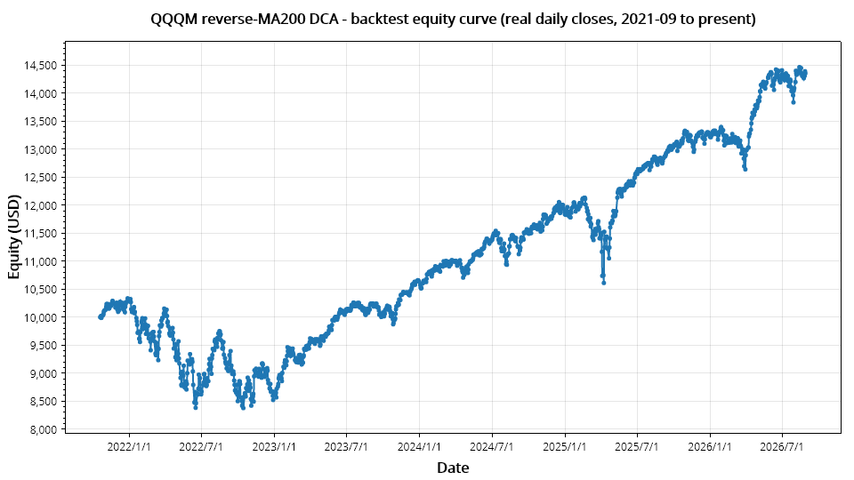
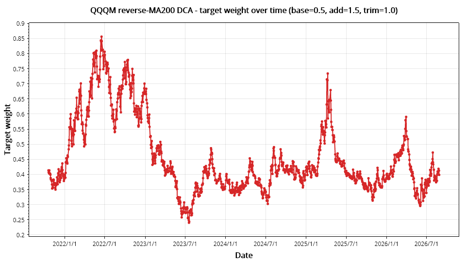
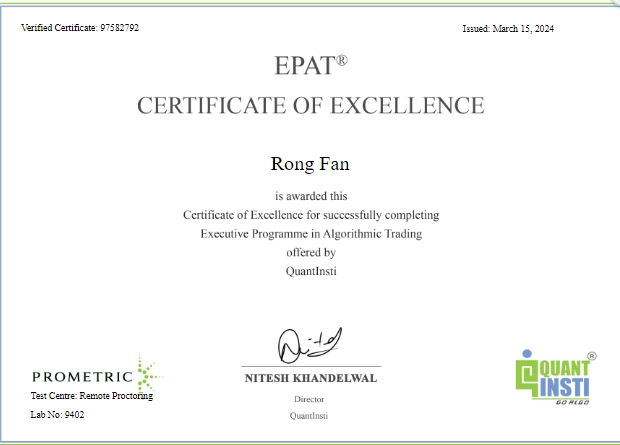

# Quant.Infra.Net

[](https://github.com/memoryfraction/Quant.Infra.Net/actions/workflows/ci.yml)  [](https://dotnet.microsoft.com/download/dotnet/8.0)  [](https://www.nuget.org/packages/Quant.Infra.Net)  [](https://www.nuget.org/packages/Quant.Infra.Net.Runtime)  [](https://www.nuget.org/packages/Quant.Infra.Net.Mcp)  [](LICENSE)

### Backtest a trading idea by *talking* to Claude, then ship the same strategy to live in C#.
### 跟 Claude 说一句话就能回测；验证通过的同一份策略，用 C# 直接上模拟盘和实盘。

> **Quant.Infra.Net** is an **agent-native** .NET quant framework. A built-in **MCP server** lets AI agents (Claude Desktop, Claude Code, Copilot, Cursor) research strategies on **free, no-key market data**, with out-of-sample checks built in. Underneath is a C# stack where **one strategy file runs in Backtest, Paper, Testnet and Live**, and data sources and brokers are swapped **by config, not code**.
>
> **Quant.Infra.Net** 是一套 **agent 原生**的 .NET 量化框架。内置 **MCP server**，AI agent 可以直接用**免费、免 key 的行情**做策略研究，并自带样本外检验，防止过拟合。底层是一套 C# 技术栈：**同一个策略文件跑回测、模拟、测试网、实盘**，数据源和券商靠**改配置**切换，不用改代码。

📖 [Docs site](https://memoryfraction.github.io/Quant.Infra.Net/) · 📦 [NuGet](https://www.nuget.org/profiles/memoryfraction) · 🐞 [Issues](https://github.com/memoryfraction/Quant.Infra.Net/issues/new) · 💡 [Discussions](https://github.com/memoryfraction/Quant.Infra.Net/discussions) · 🌐 [English](docs/readme-en.md) · [中文](docs/readme-ch.md)

---

## ✨ Highlights / 核心亮点

| | Feature / 特点 | What it means for you / 对你意味着什么 |
|---|---|---|
| 🤖 | **Agent-native, built-in MCP server**<br>**Agent 原生，内置 MCP server** | One `dotnet tool install`, one line of client config, then describe the strategy in plain language. You get metrics, a benchmark comparison and an HTML report with charts.<br>装一个工具、加一行配置，然后用大白话描述策略，直接拿到指标、基准对比和图文报告。 |
| 🆓 | **Free data, no API key**<br>**免费数据，免 API key** | Yahoo covers US, HK and China A stocks, ETFs, indices, FX and futures, adjusted for dividends and splits. Binance covers crypto. Bars are cached on disk, so re-runs take seconds.<br>Yahoo 覆盖美股/港股/A 股/ETF/指数/外汇/期货（已复权）；Binance 覆盖加密货币。本地磁盘缓存，重跑秒出。 |
| 🛡️ | **Built to resist overfitting**<br>**内置防过拟合** | `optimize_strategy` keeps an out-of-sample holdout, and `walk_forward` re-optimizes on rolling windows. Every report also breaks returns down by market regime (Bull/Bear × Calm/Volatile) and plots a rolling Sharpe.<br>网格调参自带样本外检验 + 滚动前推检验 + 牛熊/波动状态拆解 + 滚动夏普，你只相信"活下来"的参数。 |
| 🔁 | **Write once, run in 4 modes**<br>**写一次，四种模式通跑** | `Backtest` / `Paper` / `Testnet` / `Live` are one config value (`RunMode`). Every mode goes through the same 8-stage pipeline, so the backtest can't drift from live.<br>一个配置值切换模式，所有模式走同一条八阶段管线，从架构上消除"回测 ≠ 实盘"。 |
| ⏱️ | **No look-ahead by design**<br>**架构级零前视** | The engine replays bar by bar, and MCP fills default to the **next bar's open**. Warm-up history is fetched for you automatically.<br>逐 bar 回放，MCP 默认按**下一根 K 线开盘价**成交，预热数据自动补齐。 |
| 🔌 | **Swap anything by config**<br>**一切靠配置替换** | Data: Yahoo, Binance, Alpaca, Tiingo, CSV, or your own. Brokers: Binance Futures, Alpaca, Charles Schwab, Interactive Brokers. Notifications: DingTalk, WeChat Work, Email. Everything sits behind unified interfaces.<br>数据源、券商、通知全部是统一接口背后的可替换实现。 |
| 📐 | **Quant toolkit included**<br>**自带量化分析工具箱** | ADF, OLS, Z-Score, cointegration, Shapiro-Wilk, pair-trading spread, Sharpe/Calmar/MaxDD. There's also a `MultiFactor` cross-sectional rotation strategy (momentum, low-vol, trend, reversal) with a regime filter.<br>统计检验、配对交易、绩效指标、多因子轮动（含市场状态过滤）开箱即用。 |
| 🔒 | **Safe by default**<br>**默认安全** | The MCP server is **read-only and never places live orders**. Live trading only happens when *you* run the C# runtime in `Live` mode.<br>MCP **只读、永不实盘下单**；只有你自己用 C# 运行时切到 `Live` 才会真实交易。 |

---

## 🎯 Four problems, one framework / 四个痛点，一套框架

| The pain / 痛点 | How Quant.Infra.Net solves it / 怎么解决 |
|---|---|
| **Data keeps breaking.** Free feeds go stale, endpoints 404, anti-bot walls move.<br>**数据源三天两头抽风。** | The data source is a **swappable interface**. When a feed breaks, you change one config value (`Runtime:DataSource`) and the strategy stays as it is.<br>数据源是**可替换接口**，坏了就改一个配置值，策略一行不动。 |
| **You can't trust your backtester.** Look-ahead bias and hand-rolled loops that "work" in testing.<br>**回测引擎不靠谱。** | Bar-by-bar replay, next-bar-open fills, out-of-sample and walk-forward validation.<br>逐 bar 回放 + 下一根开盘成交 + 样本外与滚动前推检验。 |
| **Backtest and live are two codebases.**<br>**回测与实盘是两套代码。** | One strategy file and one 8-stage pipeline cover all four `RunMode`s, with parity regression tests between Backtest and Paper.<br>一个策略文件 + 一条管线覆盖四种模式，并有回测↔模拟一致性回归测试。 |
| **Every broker is a rewrite.**<br>**每换一个券商就要重写。** | `IBrokerService` puts Binance Futures, Alpaca, Schwab and IB behind one interface.<br>`IBrokerService` 统一封装币安合约、Alpaca、嘉信、盈透。 |

---

<a id="quickstart"></a>
## ⚡ Pick your path / 两条上手路径

| 🤖 **Path A — No code, talk to Claude** / 零代码，和 Claude 对话 | 🧑‍💻 **Path B — C# developer** / C# 开发者 |
|---|---|
| `dotnet tool install -g Quant.Infra.Net.Mcp`<br>Add it to your AI client, then ask in plain language → [jump](#mcp)<br>装好工具、加到 AI 客户端，然后直接提问 | `git clone` → `dotnet run ... -- QqqmDoc`<br>A real backtest offline in 60 seconds → [jump](#run)<br>60 秒离线跑通真实回测 |

---

<a id="mcp"></a>
## 🤖 Path A: backtest in plain language with Claude / 零代码：用自然语言让 Claude 帮你回测

> **New in MCP server 1.6.** Install one .NET tool, add one line to your AI client, then *talk* to it. The data is free and no API key is needed.
> **MCP server 1.6 新增。** 装一个 .NET 工具，在 AI 客户端里加一行配置，然后直接*对话*。数据免费，不需要 API key。

**① Install / 安装** (requires the [.NET 8+ SDK](https://dotnet.microsoft.com/download) / 需要 .NET 8+ SDK)

```bash
dotnet tool install -g Quant.Infra.Net.Mcp
```

**② Add to Claude Desktop / 加到 Claude Desktop** (`claude_desktop_config.json`)

```json
{ "mcpServers": { "quant-infra-net": { "command": "quant-infra-mcp" } } }
```

Claude Code / 用 Claude Code：

```bash
claude mcp add quant-infra-net -- quant-infra-mcp
```

> With the .NET 10 SDK you can skip step ① and use `"command": "dnx", "args": ["Quant.Infra.Net.Mcp", "--yes"]`.
> 装了 .NET 10 SDK 可以跳过第①步，直接用 `"command": "dnx", "args": ["Quant.Infra.Net.Mcp", "--yes"]`。

**③ Just ask / 直接问**

> *"Rotate between SPY, QQQ, IWM, EFA, EEM, TLT, GLD and DBC since 2008. Each month hold the 3 with the strongest momentum, preferring calmer ones, and switch to SHY when SPY is below its 200-day average. Compare to SPY and give me the report."*
> *"在 SPY、QQQ、IWM、EFA、EEM、TLT、GLD、DBC 之间轮动，从 2008 年开始。每月持有动量最强的 3 只，同等条件下优先选波动小的；SPY 跌破 200 日均线时切到 SHY。和 SPY 对比，给我报告。"*
>
> *"Which MA period works best for QQQ, and does it still hold out of sample?"* / *"QQQ 用多少日均线最好？样本外还成立吗？"*
>
> *"Does this only work in bull markets? Run a walk-forward."* / *"这个策略是不是只在牛市有效？做一次滚动前推检验。"*

**What you get / 你会得到：**
- Metrics vs a buy-and-hold benchmark, a market-regime breakdown, calendar-year and monthly returns, and automatic warnings.
- A **self-contained HTML report with charts**: equity vs benchmark, drawdown, rolling Sharpe, a regime table, a monthly heatmap and the fills.
- Fast iteration. Say "make it monthly", "add a low-vol factor" or "what if I skip the last month?" and it re-runs in seconds, because downloaded data is cached.
- 指标与"买入持有"基准的对比、市场状态拆解、年度/月度收益、自动风险提示。
- 一份**自包含的图文 HTML 报告**：权益 vs 基准、回撤、滚动夏普、市场状态表、月度热力图、成交明细。
- 继续对话迭代（"改成月度调仓""加一个低波动因子""跳过最近一个月试试"），数据有缓存，几秒出结果。

| Tool / 工具 | What it does / 作用 |
|---|---|
| `run_backtest` | One backtest with metrics, benchmark, regimes and an HTML report. Strategies: `MaCross`, `MeanReversion`, `PairTradingZScore`, **`MultiFactor`** / 单次回测 + 基准 + 市场状态 + 图文报告 |
| `optimize_strategy` | Grid search with an **out-of-sample holdout**. It reports the most *robust* parameters (not just the in-sample best) and flags overfitting / 网格调参 + 样本外检验，给出最稳健参数并识别过拟合 |
| `walk_forward` | Rolling re-optimization that trades the next unseen window each time, then stitches the out-of-sample results. Reports % profitable windows, parameter stability and WF efficiency / 滚动前推：每段训练选参、下一段盲测，拼接样本外曲线 |
| `list_data_sources` | Free sources first: **Yahoo** and **Binance** need no key. **Tiingo** needs a free key. **LocalFile** uses your own CSVs / 免费数据源目录 |
| `list_strategies` · `fetch_ohlcv` · `run_paper_cycle` | Strategy catalog, raw bars, and one paper-trading cycle / 策略目录、原始 K 线、单次纸面模拟 |
| Prompts: `quickstart` · `strategy_research` · `regime_check` | One-click guided workflows in Claude Desktop / Claude Desktop 里一键启动的引导流程 |

**When strategies stop working (style / regime shifts) / 风格切换怎么办：** a strategy that worked in one period often fails in the next. The server handles this in four layers.
一个策略在某段时间有效、换一段就失效，是常态。这里分四层应对：

1. **Diagnose / 诊断.** Every report splits returns by regime and plots a rolling 6-month Sharpe, so you can see *when* the edge disappears. / 按"牛熊 × 平稳/动荡"拆解收益，画滚动 6 个月夏普，看清优势在*哪段时间*消失。
2. **Validate / 验证.** Only trust parameters that *survive* out of sample, not the ones that peaked in-sample. / 只相信在样本外*活下来*的参数。
3. **Adapt / 自适应.** The stitched curve from `walk_forward` shows what continuous re-tuning would actually have earned. / `walk_forward` 拼接的样本外曲线就是"持续自适应调参"真实能拿到的收益。
4. **Defend / 防御.** `MultiFactor` adds a regime filter (go to cash or a `defensiveSymbol` below the 200-day average), an absolute-momentum filter, and factor blending. / 市场状态过滤 + 绝对动量过滤 + 多因子混合，不把鸡蛋押在单一风格上。

📖 Full guide / 完整指南：[MCP Server (EN)](docs/manual/mcp-server-en.md) · [AI Agent 接入（中文）](docs/manual/mcp-server-ch.md)

---

## ✅ A real backtest, not a mock / 一个真实回测，不是假数据

The bundled `QQQM reverse-MA200 DCA` strategy runs on **real QQQM daily closes (2020-12-01 → 2026-08-27)**. The console output and charts below come from the actual run.
内置的 `QQQM 逆向 MA200 定投` 策略跑在 **QQQM 真实日线（2020-12-01 → 2026-08-27）** 上，控制台输出与图表均取自真实运行。





> Target weight over time. The strategy holds more when price is below the SMA200 and trims when it is above (contrarian buy-the-dip).
> 目标仓位随时间变化：价格低于 SMA200 时加仓，高于时减仓（逆向抄底）。

| Metric | Value | Note |
|--------|-------|------|
| Initial → Final equity | **$10,000 → $14,556** | **+45.6%** over ~5.7 years |
| CAGR | **8.0%** | 1,241 tradable bars after a 200-bar warm-up |
| Max Drawdown | **−18.82%** | buy-and-hold over the same window: ≈ −35% |
| Sharpe | **0.67** | buy-and-hold over the same window: 0.72 |
| Win Rate / Trades | **52.9% / 684** | daily rebalancing decisions |

> 📊 **More real-data backtests / 更多真实回测:** all 10 CLEC allocation mixes (433, 703, 442 …) on real QQQ / QLD / BIL prices, 2007 → 2026, one report per mix with Mermaid charts. See [docs/backtests](docs/backtests/README.md). Try the mixes interactively at [Alpha Wealth Lab](https://www.alpha-wealth-lab.com/planner/allocation/).
> 全部 10 个 CLEC 配置阵型（433、703、442 …）基于 QQQ / QLD / BIL 真实价格的 2007 → 2026 回测，每个阵型一份带 Mermaid 图表的报告，见 [docs/backtests](docs/backtests/README.md)。

> **This is a comparison, not a verdict.** Compared with buy-and-hold, reverse-DCA gives up a little Sharpe in exchange for roughly half the drawdown. Which profile suits you depends on your risk tolerance, income and stage of life. Quant.Infra.Net produces the numbers; **you** make the decision.
> **这是一次对比，而不是好坏判断。** 相比买入持有，逆向定投用略低的夏普换来了约一半的最大回撤。哪个更适合，取决于你的风险偏好、收入和人生阶段。框架给出数字，**判断由你来做**。

---

<a id="run"></a>
## 🚀 Path B: run the real backtest in 60 seconds / 一分钟跑通真实回测

**Prereqs:** [.NET 8 SDK](https://dotnet.microsoft.com/download/dotnet/8.0). No API keys and no broker account are needed, because the default run is fully offline.
**前置条件：** .NET 8 SDK。不需要 API key，也不需要券商账户，默认完全离线运行。

```bash
git clone https://github.com/memoryfraction/Quant.Infra.Net.git
```

```bash
cd Quant.Infra.Net
```

```bash
dotnet run --project src/Quant.Infra.Net.Runtime.Console -- QqqmDoc
```

**Expected output (abridged) / 预期输出（节选）:**

```
=== Quant.Infra.Net CompleteWalkthrough — QQQM reverse-MA200 DCA (real data backtest) ===
bars loaded: 1441  (2020-12-01 .. 2026-08-27)
initial equity: 10000 USD | warmup bars: 200 | commission/slippage: 0 bps | fill: SameBarClose
=== backtest metrics (real run) ===
bars=1241  trades=684
CAGR=8.00%  Sharpe=0.67  Calmar=0.43
MaxDrawdown=-18.82%  WinRate=52.9%  ProfitFactor=1.16  Commission=0 USD
```

> **Why no network is needed:** the example reads a **local cached snapshot of real QQQM daily closes** (`docs/assets/_qqqm_yfinance.json`), so it is deterministic. If that file is missing, it falls back to the free public **Stooq** feed. Refresh the cache with `node docs/assets/qqqm_fetch_data.js`.
> **为什么不需要联网：** 示例优先读取**本地缓存的真实 QQQM 日线快照**，完全确定性；文件缺失时回退到免费公共 **Stooq** 行情。可用 `node docs/assets/qqqm_fetch_data.js` 刷新缓存。

**Switch the mode with ONE config value / 用一个配置值切换模式：**

| `RunMode` | What happens | Data | Execution |
|-----------|--------------|------|-----------|
| `Backtest` | Replays historical bars and prints metrics (the run above) | historical | in-memory, zero network |
| `Paper` | Full event trail on a simulated broker, no real orders | live feed | in-memory paper broker |
| `Testnet` | Real broker API in the testnet sandbox | live feed | Binance testnet |
| `Live` | Real broker API in production | live feed | Binance live |

---

## 📦 Install the NuGet packages / 安装 NuGet 包

The project ships as a **family of packages**. Most C# users only need `Quant.Infra.Net.Runtime`, which pulls in the rest.
项目由**一组包**组成。大多数 C# 用户只需装 `Quant.Infra.Net.Runtime`，其余依赖会自动带上。

| Package | Version | What it gives you |
|---------|---------|-------------------|
| [`Quant.Infra.Net.Mcp`](https://www.nuget.org/packages/Quant.Infra.Net.Mcp) | 1.6.0 | .NET tool / MCP server for AI agents: backtest, optimize, walk-forward, HTML reports, free data |
| [`Quant.Infra.Net.Runtime`](https://www.nuget.org/packages/Quant.Infra.Net.Runtime) | 1.6.0 | Unified `RunMode` switch (Backtest/Paper/Testnet/Live) and the one-file-per-strategy plugin convention. **Recommended entry point** |
| [`Quant.Infra.Net.Backtest`](https://www.nuget.org/packages/Quant.Infra.Net.Backtest) | 1.6.0 | Event-driven, bar-by-bar backtest engine with look-ahead guards and parameter sweeps |
| [`Quant.Infra.Net.Orchestration`](https://www.nuget.org/packages/Quant.Infra.Net.Orchestration) | 1.6.0 | Strategy pipeline: signal → risk → target position → execution → portfolio state |
| [`Quant.Infra.Net`](https://www.nuget.org/packages/Quant.Infra.Net) | 1.5.3 | Core: data sources, brokers and order execution, statistical analysis, portfolio analytics, notifications |

**Dependency chain / 依赖链:** `Runtime 1.6.0` → `Backtest 1.6.0` + `Orchestration 1.6.0` → `Quant.Infra.Net 1.5.3`

```bash
dotnet add package Quant.Infra.Net.Runtime
```

If you only need the building blocks (data, broker, analysis, notifications) without the strategy pipeline:
若只需数据/券商/分析/通知等构件，不需要策略管线：

```bash
dotnet add package Quant.Infra.Net
```

---

## ✍️ Modify the strategy to test your own idea / 改一下策略，验证自己的想法

The whole QQQM strategy is **one ~30-line method** in [`QqqmReverseDcaStrategy.cs`](src/Quant.Infra.Net.Runtime.Console/Strategies/QqqmReverseDcaStrategy.cs). Change the numbers or the symbol, add your own logic, and re-run the same backtest. The framework itself doesn't change.
整个 QQQM 策略就是**一个约 30 行的方法**。改参数、换标的、加自己的逻辑，然后重跑同一个回测，框架代码不用动。

```csharp
protected override async Task ExecuteCoreAsync(IPipelineContext context, CancellationToken ct)
{
    var symbol        = context.GetParameter("Symbol") ?? "QQQM";
    var maPeriod      = Math.Max(2, GetInt(context, "MaPeriod", 200));
    var baseWeight    = GetDouble(context, "BaseWeight", 0.5);
    var addIntensity  = GetDouble(context, "AddIntensity", 1.5);
    var trimIntensity = GetDouble(context, "TrimIntensity", 1.0);

    var closes = await LoadClosesAsync(context, symbol, ct);   // base class loads for you
    var close  = closes[^1];
    var sma    = closes.TakeLast(maPeriod).Average();

    var targetWeight = QqqmReverseDcaStrategy.ComputeTargetWeight(
        close, sma, baseWeight, addIntensity, trimIntensity,
        GetDouble(context, "MinWeight", 0.0), GetDouble(context, "MaxWeight", 1.0));

    var signal = new Signal { Symbol = symbol, GeneratedUtc = DateTime.UtcNow,
        Direction = targetWeight > 0 ? SignalDirection.Long : SignalDirection.Flat,
        Strength = targetWeight,
        Reason = $"close={close} SMA{maPeriod}={sma:F4} targetWeight={targetWeight:F4}" };
    Publish(context, new Signal(), new TargetPosition { Symbol = symbol, TargetWeight = targetWeight });
}
```

**Tweak parameters without code changes / 调参数（零代码）：** set them under `Orchestration:Parameters` in `appsettings.json`.

| Parameter | Default | Meaning |
|-----------|---------|---------|
| `Symbol` | `QQQM` | Any symbol your data source serves |
| `MaPeriod` | `200` | SMA window |
| `BaseWeight` | `0.5` | Target weight at the MA |
| `AddIntensity` | `1.5` | How hard to add when price is *below* the MA |
| `TrimIntensity` | `1.0` | How hard to trim when price is *above* the MA |

**Add a brand-new strategy in one file / 新增一个策略（一个文件）：**

1. Create `MyStrategy.cs`: implement `IStrategyDescriptor` wrapping an `ISignalGenerator`, or subclass `Strategy` and override `ExecuteCoreAsync`. `ExampleCustomStrategy.cs` shows the minimal case.
2. `AddQuantInfraNet(..., strategyAssemblies: typeof(MyStrategy).Assembly)` discovers it by reflection.
3. Set `Orchestration:Parameters:Strategy = "MyStrategy"`. It now runs in **Backtest, Paper, Testnet and Live** with identical logic.

> The strategy is a *plugin* on a fixed pipeline. Risk gate, execution, portfolio state and notifications come from the framework; you only supply the signal/weight logic.
> 策略是固定管线上的*插件*：风控、执行、组合状态、通知都由框架提供，你只写信号/权重逻辑。

---

## 📡 Data sources: never a single point of failure / 数据源：不把命门押在一处

> **Data is the #1 reason quant projects quietly die.** A typical story: you build on an unofficial Yahoo wrapper, Yahoo changes its API, the wrapper goes unmaintained for months, and your pipeline is down the whole time. Here the data source is a **swappable interface** (`ITraditionalFinanceSourceDataService` / `ICryptoSourceDataService`), so when a feed breaks you **swap the source, not the strategy**.
> **数据源是量化项目悄悄死掉的第一原因。** 本框架把数据源设计成**可替换接口**，某个源坏了，**换数据源，而不是改策略**。

| Layer / 层 | Sources / 数据源 | Recommended / 推荐 |
|---|---|---|
| **MCP server** (AI research) | Yahoo, Binance (no key) · Tiingo, Finnhub, FMP, TwelveData (free key) · LocalFile (CSV/JSON) · Demo | Stocks/ETFs: **Yahoo**. Crypto: **Binance**. A steadier US equity feed: **Tiingo** |
| **C# Runtime** (`Runtime:DataSource`) | Demo, Yahoo, Csv, Binance, Stooq, Alpaca, Custom | **Alpaca** (free IEX tier, officially maintained `Alpaca.Markets` SDK) |
| **Your own feed** | Polygon, Databento, your broker's feed, SQL/MongoDB… | Implement the interface, register it in DI, set the config value. Strategy code is unchanged |

> ⚠️ **Free public data is for research only.** These feeds have no SLA. For live trading, point the same interface at your broker's data feed; the strategy code doesn't change.
> ⚠️ **免费公共数据仅供研究/回测**，无 SLA。实盘请让同一接口指向券商行情，策略代码不变。

---

## 🧱 Architecture / 架构

```
┌─────────────────────────────────────────────────────────────────┐
│  AI agents (Claude / Copilot / Cursor)  ──►  Quant.Infra.Net.Mcp │
│  run_backtest · optimize_strategy · walk_forward · HTML reports  │
├─────────────────────────────────────────────────────────────────┤
│                 Your Strategy (write once, run anywhere)          │
├─────────────────────────────────────────────────────────────────┤
│  UNIFIED RUNTIME / 统一运行时 (Quant.Infra.Net.Runtime)            │
│  AddQuantInfraNet + ONE switch: RunMode = Backtest|Paper|Testnet|Live │
│  ─────────────────────────────────────────────────────────────── │
│  Orchestration / 编排层 — the same 8 stages in every mode:          │
│  DataIngest → Analysis → Signal → TargetPosition → Risk           │
│  → Execution → PortfolioState → Notification                      │
│  ─────────────────────────────────────────────────────────────── │
│  Backtest / 回测层 — replay clock, bar by bar, zero look-ahead      │
└──────────────────────────────┬──────────────────────────────────┘
                               │ unified interfaces
   ┌───────────────────────────┼───────────────────────────┐
   ▼                           ▼                           ▼
┌──────────────┐        ┌───────────────┐          ┌──────────────┐
│ Source Data  │        │ Broker/Orders │          │ Notification │
│ Yahoo        │        │ Binance Futures│         │ DingTalk     │
│ Binance      │        │ Alpaca        │          │ WeChat Work  │
│ Alpaca/Tiingo│        │ Schwab        │          │ Email (SMTP) │
│ CSV/SQL/Mongo│        │ Interactive   │          │ Brevo        │
└──────────────┘        │ Brokers       │          └──────────────┘
                        └───────────────┘
```

---

## Is this for you? / 这适合我吗？

**✅ Yes, if you / 适合你，如果你：**
- Want to test trading ideas fast with an AI assistant, without writing code first. / 想先用 AI 快速验证想法，不急着写代码。
- Build trading systems in .NET and want **data → signal → risk → execution → portfolio** in one consistent pipeline instead of five disconnected SDKs. / 用 .NET 做交易系统，希望一条管线贯通，而不是拼五个 SDK。
- Want to prove a strategy on historical data *before* touching a real broker, with the *same* code going live afterwards. / 回测优先，并且上线用的是同一份代码。
- Need statistical tools (ADF, OLS, Z-Score, cointegration) and multi-broker execution behind unified interfaces. / 需要统计工具箱和统一的多券商执行层。

**❌ Not for you, if you want / 不适合你，如果你要的是：**
- A turnkey "get rich" bot. This is *infrastructure*; you bring the strategy. / 一键躺赚机器人。这是*基础设施*，策略由你来写。
- A Python-only stack. / 纯 Python 技术栈。
- A guarantee of profit. Past backtest performance does not indicate future results. / 收益保证。回测表现不代表未来收益。

---

## 📚 Documentation / 文档

| Document | Description |
|----------|-------------|
| 📖 [**GitHub Pages**](https://memoryfraction.github.io/Quant.Infra.Net/) | Bilingual documentation site with modules, API and examples |
| [🤖 **MCP Server (EN)**](docs/manual/mcp-server-en.md) / [AI Agent 接入（中文）](docs/manual/mcp-server-ch.md) | Install, client config, every tool and prompt, data sources, the no-live-order boundary |
| 📊 [**CLEC allocation backtests**](docs/backtests/README.md) / [CLEC 阵型回测](docs/backtests/README.md) | 10 mixes (433, 703, 442 …) on real QQQ / QLD / BIL data, 2007–2026: one report per mix with Mermaid charts, stress tests and calendar-year returns. Reproduce with `-- ClecDoc` |
| [Complete Walkthrough (EN)](docs/CompleteWalkthrough-en.md) / [完整图文教程](docs/CompleteWalkthrough-ch.md) | From a few lines of code to the real QQQM backtest |
| [Unified Runtime Quick Start (EN)](docs/UnifiedRuntimeQuickStart-en.md) / [统一运行时使用说明](docs/UnifiedRuntimeQuickStart-ch.md) | Run Backtest/Paper with one config value; swap data source, strategy or credentials |
| [Orchestration Quick Start (EN)](docs/OrchestrationQuickStart-en.md) / [编排层使用说明](docs/OrchestrationQuickStart-ch.md) | The demo's data source, symbol and strategy, and how to swap in your own |
| [Backtest Quick Start (EN)](docs/BacktestQuickStart-en.md) / [回测引擎使用说明](docs/BacktestQuickStart-ch.md) | Bar-by-bar engine, look-ahead guards, metrics, parameter sweeps |
| [How-to Guides (EN)](docs/manual/README-en.md) / [任务导向深度指南](docs/manual/README-ch.md) | Configuration reference, writing a strategy, custom risk/data source/broker, testing & deployment, FAQ |
| [Orchestration Design](docs/OrchestrationLayerDesign.md) · [Runtime Design](docs/TradingRuntimeDesign.md) · [Architecture](docs/Architect.md) | Design documents |
| [User Manual](docs/Manual.md) · [Code Standards](docs/CodeStandard.md) | Module usage guide and API examples · coding conventions |

---

## ❓ FAQ / 常见问题

**Q: Can I backtest a strategy just by describing it to an AI? / 能不能用自然语言让 AI 帮我回测？**
A: Yes. Install the MCP server, add it to Claude Desktop or Claude Code, and describe your idea. It uses free Yahoo / Binance data, writes an HTML report with charts, and can optimize and walk-forward-test the strategy on request. See [Path A](#mcp). / 可以：装 MCP server、加到 Claude，然后用一句话描述策略即可。

**Q: How do I backtest crypto strategies in C#? / 怎么用 C# 回测加密货币策略？**
A: Use the backtest engine with the built-in Binance data source. Write the strategy as a target-weight or signal function, and `BacktestRunner` returns CAGR, Sharpe, Calmar, MaxDrawdown, WinRate and ProfitFactor. / 用回测引擎 + 内置币安数据源，`BacktestRunner` 直接给出全套绩效指标。

**Q: What's a good .NET library for pair trading? / .NET 做配对交易用什么库？**
A: Quant.Infra.Net ships OLS spread regression, spread z-score and cointegration (ADF) checks, plus a `PairTradingZScore` strategy, so you can build and backtest pairs strategies in C#. / 内置 OLS 价差回归、价差 z-score、协整检验和 `PairTradingZScore` 策略。

**Q: How do I connect Interactive Brokers from .NET? / 怎么用 .NET 接盈透？**
A: Use the unified `IBrokerService` abstraction. Interactive Brokers (via InterReact), Alpaca, Charles Schwab and Binance Futures all sit behind one interface. / 用统一的 `IBrokerService` 接口，盈透、Alpaca、嘉信、币安合约同一套调用。

**Q: Does it support multi-factor backtests? / 支持多因子回测吗？**
A: Yes, through the `MultiFactor` strategy: cross-sectional rotation over a universe, scored by weighted z-scores of momentum, low volatility, trend, short-term reversal and risk-adjusted momentum, with optional absolute-momentum and regime filters. Fundamental factors (value, quality) need a fundamentals feed and are not built in yet. / 支持价格/波动类多因子横截面轮动；估值、质量等基本面因子暂未内置。

**Q: How is this different from a hosted platform like QuantConnect? / 和 QuantConnect 这类云平台有什么不同？**
A: Quant.Infra.Net is a compact, self-hosted set of NuGet packages that you own and extend, with an MCP server so AI agents can drive the research loop directly. / 它是一组可自托管、完全归你掌控的 NuGet 包，并且内置 MCP server，让 AI agent 直接驱动研究流程。

---

## 🗒️ Changelog / 变更记录

| Date | Change / 变更 |
|---|---|
| 2026-11-03 | **CLEC allocation backtests**: `ClecAllocationStage` (multi-asset, annual rebalance) and the `ClecDoc` host backtest all 10 mixes from Alpha Wealth Lab's allocation planner on real adjusted QQQ / QLD / BIL closes and write [docs/backtests](docs/backtests/README.md). / 10 个 CLEC 阵型的真实数据回测报告。 |
| 2026-11-03 | **MCP server 1.6.0** ships as a .NET tool (`dotnet tool install -g Quant.Infra.Net.Mcp` or `dnx`). Adds free no-key data (Yahoo, Binance) plus Tiingo, a disk cache, the `MultiFactor` rotation strategy, self-contained HTML reports, benchmark and market-regime analysis, `optimize_strategy` with an out-of-sample holdout, `walk_forward`, `list_data_sources`, MCP prompts, automatic warm-up, and next-bar-open fills by default. Default sizing for single-symbol strategies is now 100% (was 30%). / MCP 1.6：免费数据源、多因子、图文报告、市场状态分析、样本外优化、滚动前推。 |
| 2026-08-29 | **v1.6.0: three new NuGet packages**, `Quant.Infra.Net.Orchestration`, `Quant.Infra.Net.Backtest` and `Quant.Infra.Net.Runtime`, with the unified `RunMode` switch and the one-file-per-strategy plugin convention. |
| 2026-07-20 | Phase 2 unified runtime: `AddQuantInfraNet` as the single entry point and `RunMode` as the single switch; Backtest↔Paper parity regression tests; demo hosts merged into `Quant.Infra.Net.Runtime.Console`. |

Full history: [src/CHANGELOG.md](src/CHANGELOG.md)

---

## 🎓 About the maintainer / 关于维护者



> **Certified in Algorithmic Trading: EPAT®, QuantInsti (2024).** / 维护者已通过 QuantInsti 颁发的 **EPAT® 算法交易认证**（2024 年）。
>
> 📝 EPAT graduation project / 毕业项目: [Crypto Perpetual Contract Pair Trading (QuantInsti Blog)](https://blog.quantinsti.com/crypto-perpetual-contract-pair-trading-project-rong-fan/)

**Related projects / 相关项目**

| Project | Description |
|---|---|
| [LLSDA](https://github.com/memoryfraction/LLSDA-Lightning-Location-System-Data-Analyzer) | Open-source lightning location system (LLS) data analysis library, published on NuGet and cited in a TechRxiv preprint. / 开源闪电定位系统数据分析类库，已发布 NuGet 并被 TechRxiv 预印本引用。 |
| [HealthData-Interoperability-Csharp](https://github.com/memoryfraction/HealthData-Interoperability-Csharp) | AI-driven FHIR R4/R5 healthcare interoperability engine for .NET. / 基于 .NET 的 AI 驱动 FHIR R4/R5 医疗数据互操作引擎。 |

More projects: [github.com/memoryfraction](https://github.com/memoryfraction)

---

## 🙋 Support & Feedback / 问题反馈与功能支持

Hit a problem, or need support for something that isn't here yet? **Get in touch; that's how the roadmap gets built.** I read every message.
遇到问题，或者需要框架支持某个还没有的功能？**请直接联系我，路线图就是这样来的。** 每一条我都会看。

| I want to… / 我想… | Go to / 前往 |
|---|---|
| 🐞 Report a bug / 报告 Bug | [**Open an Issue →**](https://github.com/memoryfraction/Quant.Infra.Net/issues/new) |
| ✨ Request a feature, broker or data source / 需要新功能、券商或数据源 | [**Open an Issue →**](https://github.com/memoryfraction/Quant.Infra.Net/issues/new) |
| 💡 Ask a question or share an idea / 使用疑问、想法交流 | [**Start a Discussion →**](https://github.com/memoryfraction/Quant.Infra.Net/discussions) |
| 🔒 Report a security vulnerability / 报告安全漏洞 | [SECURITY.md](SECURITY.md) (please don't open a public issue / 请勿公开提交) |

> Tip: include your package version, .NET version and a minimal repro to get an answer faster.
> 小提示：附上包版本、.NET 版本和最小复现代码，能大大加快回复速度。

⭐ **If this project saves you time, a star helps others find it. / 如果这个项目帮你省了时间，点个 Star 让更多人看到。**

---

## 💼 Business Inquiries / 商务合作

Using Quant.Infra.Net in a commercial product or team? / 想在商业产品或团队中使用 Quant.Infra.Net？

| Option | What you get | Starting at / 起价 | Start |
|---|---|---|---|
| **1 · Consulting / 咨询** | 30–60 min on architecture, data, execution or backtest design | **$200/hr** | [Book 30 min](https://calendly.com/rex-fan18/30min) |
| **2 · Broker Integration / 券商集成** | Wire one broker (Schwab / Interactive Brokers / Binance / Alpaca) into your stack: auth, order routing, positions/fills sync | **$5,000** | [Book a scoping call](https://calendly.com/rex-fan18/30min) |
| **3 · Multi-Broker Execution Layer / 多券商执行层** | Unified execution across 2+ brokers with backtest → paper → live parity | **$12,000** | [Book a scoping call](https://calendly.com/rex-fan18/30min) |
| **4 · Bespoke / 定制开发** | Custom modules scoped to your product | **$15,000+** | [Book a scoping call](https://calendly.com/rex-fan18/30min) |
| **5 · E-book / 电子书** | 《区块链量化投资实战 / Blockchain Quant Trading in Practice》 | — | [Amazon](https://www.amazon.com/dp/B0D7W89ZQD) · [小红书笔记](https://www.xiaohongshu.com/discovery/item/6a9366b4000000002102fbff) |

- **Email / 邮箱**: [rex.fan18@gmail.com](mailto:rex.fan18@gmail.com)
- **Book a call / 预约会议**: [calendly.com/rex-fan18/30min](https://calendly.com/rex-fan18/30min)

> The open-source code is MIT-licensed and free for commercial use. Paid services cover consulting, onboarding and bespoke development. Prices are starting points; the final quote is set on the scoping call. Details: [docs/Commercial.md](docs/Commercial.md).
> 开源版本遵循 MIT 许可，可免费商用；付费服务覆盖咨询、落地接入与定制开发。以上为起价，最终报价在沟通后确认。

---

> **Disclaimer / 免责声明**: see [DISCLAIMER](docs/DISCLAIMER.md) for the full disclaimer and limitation of liability. Backtest performance is not indicative of future results. **Not investment advice.** / 回测表现不代表未来收益。**非投资建议。**
