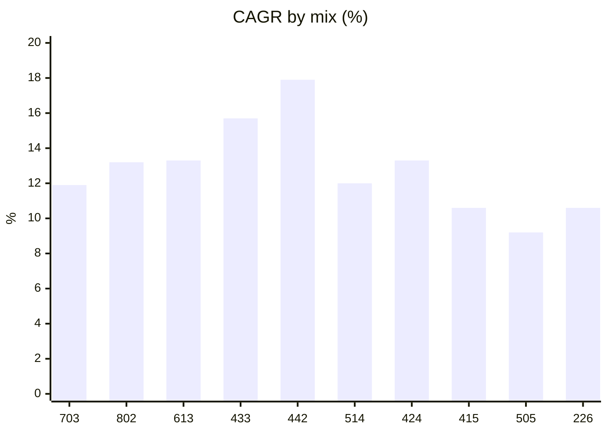
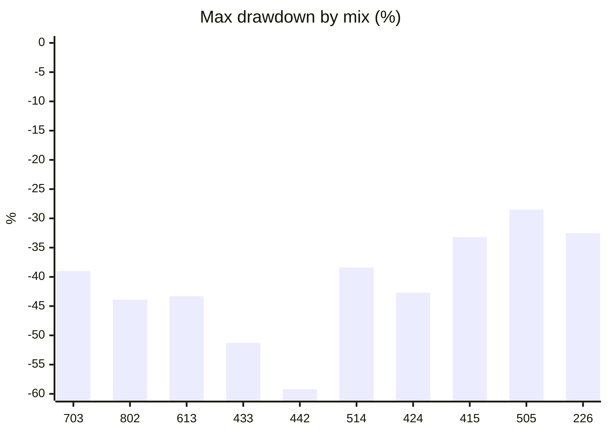

# CLEC allocation backtests / CLEC 阵型回测总览

> Every mix from [Alpha Wealth Lab · 433 Allocation & Beta Check](https://www.alpha-wealth-lab.com/planner/allocation/) backtested on **real adjusted daily closes, 2007-06-01 → 2026-10-30** (19.4 years, including 2008, 2020 and 2022), with **QQQ** as the base index, **QLD** as the 2x leveraged ETF and **BIL** as cash. Each mix is rebalanced on the first trading day of each year. Generated by [Quant.Infra.Net](../../README.md).
>
> 把 [Alpha Wealth Lab · 433 配置与 Beta 体检](https://www.alpha-wealth-lab.com/planner/allocation/) 里的每个阵型，用**真实复权日线（2007-06-01 → 2026-10-30，19.4 年，含 2008、2020、2022）**逐一回测：原型 = **QQQ**，二倍杠杆 = **QLD**，现金 = **BIL**，每年第一个交易日再平衡。由 [Quant.Infra.Net](../../README.md) 生成。

| Mix / 阵型 | Weights / 比例 | Beta | $10k → | CAGR | Max DD / 最大回撤 | 2008 crisis / 金融危机 | 2022 | Sharpe | Calmar | Report / 报告 |
|---|---|---:|---:|---:|---:|---:|---:|---:|---:|---|
| **703** | 70 / 0 / 30 | 0.7 | $89,360 | 11.9% | -39.0% | -39.0% | -24.5% | 0.81 | 0.31 | [clec-703.md](clec-703.md) |
| **802** | 80 / 0 / 20 | 0.8 | $111,597 | 13.2% | -43.9% | -43.9% | -28.1% | 0.79 | 0.30 | [clec-802.md](clec-802.md) |
| **613** | 60 / 10 / 30 | 0.8 | $111,978 | 13.3% | -43.3% | -43.3% | -27.3% | 0.81 | 0.31 | [clec-613.md](clec-613.md) |
| **433** | 40 / 30 / 30 | 1.0 | $169,270 | 15.7% | -51.3% | -51.3% | -33.0% | 0.79 | 0.31 | [clec-433.md](clec-433.md) |
| **442** | 40 / 40 / 20 | 1.2 | $242,650 | 17.9% | -59.2% | -59.2% | -39.5% | 0.77 | 0.30 | [clec-442.md](clec-442.md) |
| **514** | 50 / 10 / 40 | 0.7 | $89,550 | 12.0% | -38.4% | -38.4% | -23.8% | 0.82 | 0.31 | [clec-514.md](clec-514.md) |
| **424** | 40 / 20 / 40 | 0.8 | $112,170 | 13.3% | -42.7% | -42.7% | -26.6% | 0.81 | 0.31 | [clec-424.md](clec-424.md) |
| **415** | 40 / 10 / 50 | 0.6 | $70,702 | 10.6% | -33.2% | -33.2% | -20.2% | 0.85 | 0.32 | [clec-415.md](clec-415.md) |
| **505** | 50 / 0 / 50 | 0.5 | $55,043 | 9.2% | -28.5% | -28.5% | -17.4% | 0.86 | 0.32 | [clec-505.md](clec-505.md) |
| **226** | 20 / 20 / 60 | 0.6 | $70,820 | 10.6% | -32.5% | -32.5% | -19.5% | 0.85 | 0.33 | [clec-226.md](clec-226.md) |
| *100% QQQ* | *benchmark* | 1.0 | $169,950 | 15.7% | -53.4% | -53.4% | -35.1% | 0.77 | 0.29 | — |





**How to read this / 怎么看：**
- Beta (base + 2 × leveraged) predicts the *shape*: higher beta means more return in long bull runs and deeper holes in crashes. / Beta 决定形态：Beta 越高，长牛里赚得越多，暴跌里坑越深。
- Cash is not dead weight. It caps the drawdown and, at each annual rebalance, buys the index back after a bad year. / 现金不是闲钱：它压住回撤，并在每年再平衡时把跌掉的指数买回来。
- These are past numbers on one index (Nasdaq-100), one of the strongest of the period. Pick the mix whose *worst year* you could live through, not the one with the biggest final number. / 这是过去的数据，而且纳指 100 是这段时间最强的指数之一。请选择你扛得住*最差年份*的阵型，而不是终值最大的那个。

## Method & caveats / 方法与局限

- **Data / 数据:** Yahoo Finance daily *adjusted* closes (dividends and splits reinvested) for QQQ, QLD and BIL, cached in [`docs/assets/_clec_yfinance.json`](../assets/_clec_yfinance.json). BIL (1–3 month T-bills) stands in for the cash sleeve because SGOV / BOXX only start in 2020. / Yahoo 复权日收盘价；现金用 BIL（1–3 个月美债）代替，因为 SGOV / BOXX 2020 年才上市。
- **Leverage / 杠杆:** real QLD prices, so daily-reset decay and fund fees are already in the numbers (unlike a simple "2 × index" estimate). / 使用 QLD 真实价格，已包含每日重置损耗与基金费用。
- **Engine / 引擎:** Quant.Infra.Net bar-by-bar backtester. The strategy stage only sees bars up to the current day; Risk → Execution → Portfolio state are the framework's built-in stages. / 逐 bar 回放，策略只能看到当天及以前的数据。
- **Rebalancing / 再平衡:** back to target weights on the first trading day of each calendar year, filled at that day's close, 5 bps commission + 2 bps slippage per trade. No taxes, no withdrawals, no contributions. / 每年首个交易日按收盘价再平衡，每笔 5 bp 佣金 + 2 bp 滑点；未计税、无提领、无追加投入。
- **Sharpe** uses a 0% risk-free rate. / Sharpe 按 0% 无风险利率计算。
- **Bias / 偏差:** QQQ is a survivor and one of the best-performing indices of 2007–2026; other indices or periods (e.g. 2000–2002, when the Nasdaq-100 fell 83%) can look much worse. / 存在幸存者偏差，2000–2002 纳指 100 跌了 83%，换个区间结果可能差很多。

**Reproduce / 复现：**

```bash
node docs/assets/clec_fetch_data.js
dotnet run --project src/Quant.Infra.Net.Runtime.Console -- ClecDoc
```

> The CLEC mixes come from the published *CLEC Handbook* methodology as implemented by Alpha Wealth Lab; this project is not affiliated with or endorsed by CLEC or its authors. Backtests are not forecasts. **Not investment advice.** / 阵型来自《CLEC 宝典》公开方法论（经 Alpha Wealth Lab 实现）；本项目与 CLEC 及作者无关联、未获背书。回测不代表未来，**不构成投资建议。**
