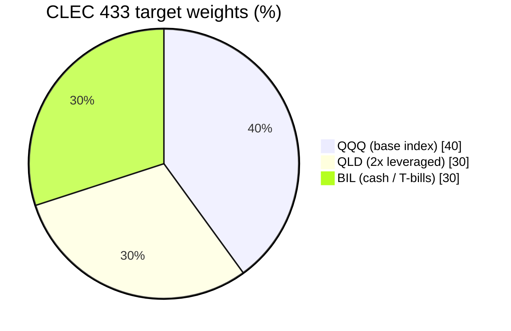
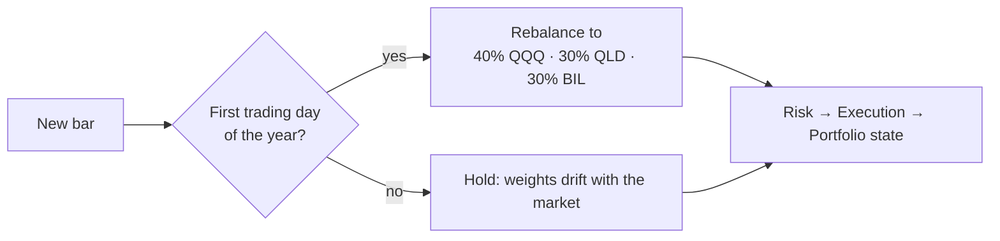
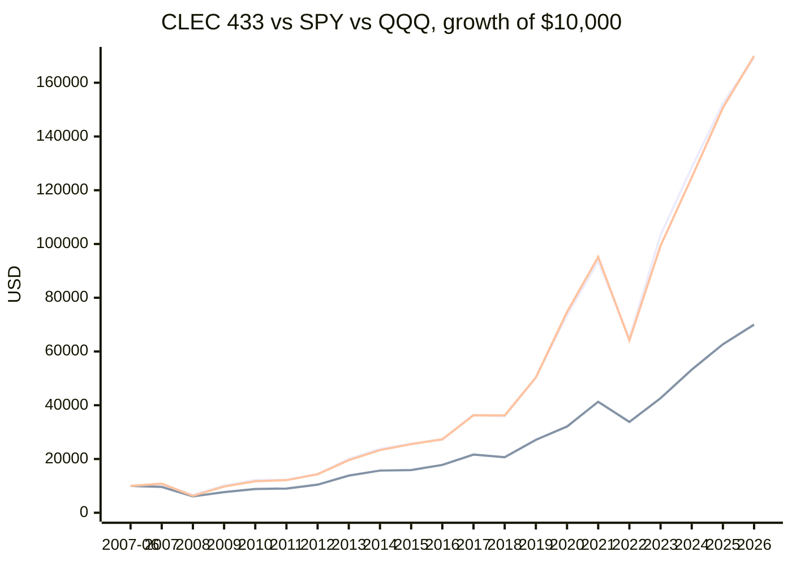
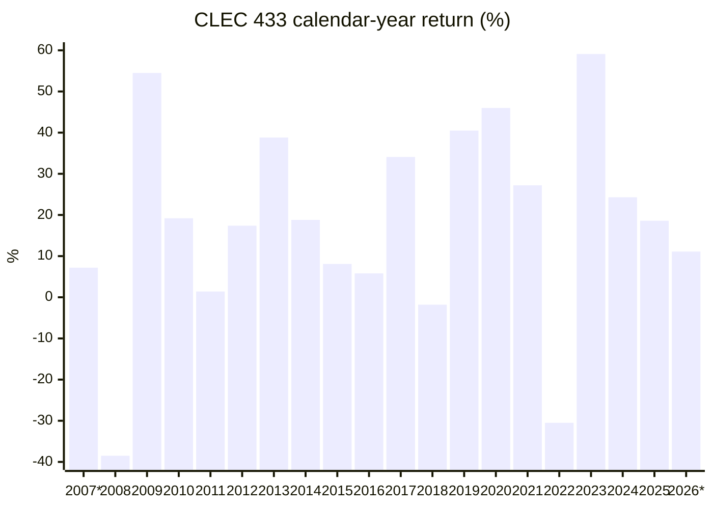
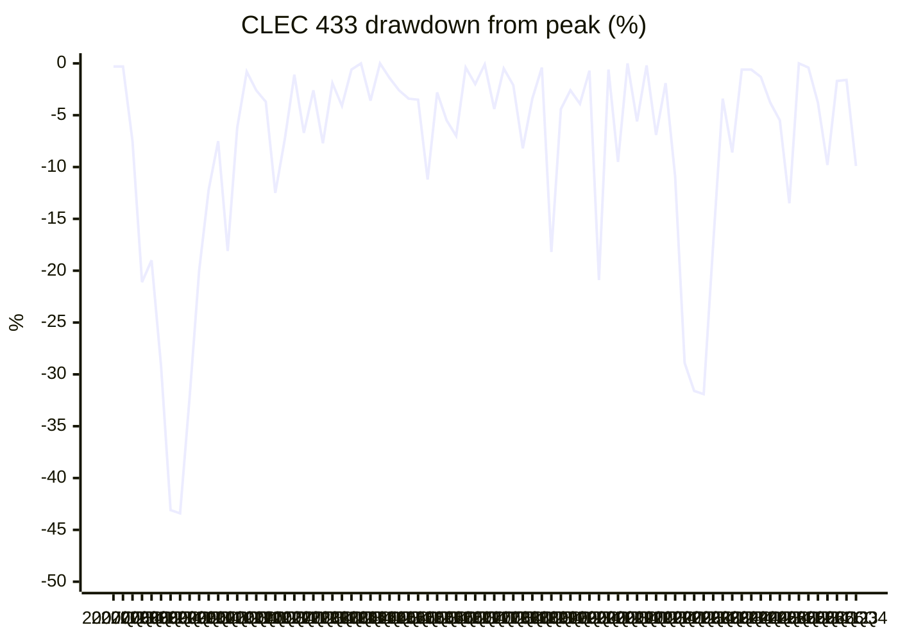

# CLEC 433 backtest / CLEC 433 阵型回测

> **433 = 40% QQQ / 30% QLD / 30% BIL** · beta 1.00 · Classic balance / 经典平衡
>
> Real adjusted daily closes, **2007-06-01 → 2026-10-30** (19.4 years), rebalanced on the first trading day of each year. Generated by [Quant.Infra.Net](../../README.md); try the mix interactively at [Alpha Wealth Lab · 433 Allocation & Beta Check](https://www.alpha-wealth-lab.com/planner/allocation/).
> 真实复权日线，**2007-06-01 → 2026-10-30**（19.4 年），每年第一个交易日再平衡。由 [Quant.Infra.Net](../../README.md) 生成；可在 [Alpha Wealth Lab · 433 配置与 Beta 体检](https://www.alpha-wealth-lab.com/planner/allocation/) 交互试算。

[← All mixes / 全部阵型](README.md) · [Optimization study / 寻优研究](clec-optimization.md)

## Result vs S&P 500 and Nasdaq-100 / 对比标普 500 与纳指 100

| Metric / 指标 | CLEC 433 | SPY (S&P 500) | QQQ (Nasdaq-100) |
|---|---:|---:|---:|
| $10,000 grows to / 一万美元变成 | **$169,270** | $70,008 | $169,950 |
| CAGR / 年化收益 | **15.69%** ✅ | 10.55% | 15.71% |
| Sharpe (rf = 0) | **0.79** ✅ | 0.61 | 0.77 |
| Calmar (CAGR / MaxDD) | **0.31** ✅ | 0.19 | 0.29 |
| Volatility / 年化波动 | 21.4% | 19.7% | 22.3% |
| Max drawdown / 最大回撤 | **-51.3%** | -55.2% | -53.4% |
| Max drawdown dates / 回撤区间 | 2007-10-31 → 2009-03-09 | 2007-10-09 → 2009-03-09 | 2007-10-31 → 2008-11-20 |
| Recovered on / 回本日 | 2010-10-28 | 2012-08-16 | 2010-12-08 |
| Best year / 最好年份 | 59.1% (2023) | 32.3% (2013) | 54.9% (2023) |
| Worst year / 最差年份 | -38.5% (2008) | -36.8% (2008) | -41.7% (2008) |
| Losing years / 亏损年数 | 3 / 20 | 4 / 20 | 3 / 20 |
| Rebalances · trades · costs / 再平衡 · 成交 · 费用 | 20 · 59 · $825 | buy & hold | buy & hold |

✅ / ❌ = beats / does not beat the S&P 500 (SPY) on that metric. / ✅ / ❌ = 该指标是否跑赢标普 500（SPY）。

Among the 10 CLEC mixes, 433 ranks **#2 by CAGR** and **#8 by Calmar** (return per unit of drawdown).
在 10 个 CLEC 阵型里，433 的**年化收益排第 2**，**Calmar（收益 / 回撤）排第 8**。

## Allocation / 配置





## Growth of $10,000 (year-end) / 一万美元净值（年末）

Line 1 = CLEC 433, line 2 = SPY (S&P 500), line 3 = QQQ. / 线 1 = CLEC 433，线 2 = SPY（标普 500），线 3 = QQQ。



## Calendar-year returns / 年度收益



| Year / 年份 | CLEC 433 | SPY | vs SPY | QQQ |
|---|---:|---:|---:|---:|
| 2007* | 7.2% | -3.7% | +10.9% | 8.2% |
| 2008 | -38.5% | -36.8% | -1.7% | -41.7% |
| 2009 | 54.5% | 26.4% | +28.1% | 54.7% |
| 2010 | 19.2% | 15.1% | +4.1% | 20.2% |
| 2011 | 1.4% | 1.9% | -0.5% | 3.5% |
| 2012 | 17.4% | 16.0% | +1.4% | 18.1% |
| 2013 | 38.8% | 32.3% | +6.5% | 36.6% |
| 2014 | 18.8% | 13.5% | +5.3% | 19.2% |
| 2015 | 8.1% | 1.2% | +6.9% | 9.4% |
| 2016 | 5.8% | 12.0% | -6.2% | 7.1% |
| 2017 | 34.1% | 21.7% | +12.4% | 32.7% |
| 2018 | -1.8% | -4.6% | +2.8% | -0.1% |
| 2019 | 40.5% | 31.2% | +9.2% | 39.0% |
| 2020 | 46.0% | 18.3% | +27.7% | 48.4% |
| 2021 | 27.2% | 28.7% | -1.6% | 27.4% |
| 2022 | -30.5% | -18.2% | -12.4% | -32.6% |
| 2023 | 59.1% | 26.2% | +33.0% | 54.9% |
| 2024 | 24.3% | 24.9% | -0.6% | 25.6% |
| 2025 | 18.6% | 17.7% | +0.8% | 20.8% |
| 2026* | 11.1% | 11.7% | -0.5% | 12.8% |

`2007*` starts on 2007-06-01; `2026*` ends on 2026-10-30 (partial years). / 带 * 的为不完整年份。

## Drawdown (quarter-end) / 回撤（季末）



## Stress test: real bear markets / 压力测试：真实熊市

Worst peak-to-trough fall of the portfolio inside each window (real QLD prices, so daily-reset decay is included).
每个区间内组合从高点到低点的最大跌幅（用的是 QLD 真实价格，已包含二倍 ETF 每日重置的损耗）。

| Window / 区间 | Dates / 日期 | CLEC 433 | SPY | QQQ |
|---|---|---:|---:|---:|
| 2007–09 financial crisis / 2007–09 金融危机 | 2007-10-31 → 2009-03-09 | **-51.3%** | -54.7% | -53.4% |
| 2011 euro-debt scare / 2011 欧债危机 | 2011-07-07 → 2011-10-03 | **-16.3%** | -18.4% | -16.1% |
| 2018 Q4 sell-off / 2018 四季度暴跌 | 2018-10-01 → 2018-12-24 | **-23.3%** | -19.2% | -22.7% |
| 2020 COVID crash / 2020 新冠暴跌 | 2020-02-19 → 2020-03-20 | **-28.1%** | -32.0% | -28.6% |
| 2022 rate-hike bear market / 2022 加息熊市 | 2021-11-19 → 2022-12-28 | **-33.0%** | -24.5% | -35.1% |

On $1,000,000 a repeat of the worst window would mean a paper loss of about **$513,379**. Cash is what lets you hold on, and add, instead of being forced to sell.
以 100 万美元计，重演最差区间约浮亏 **$513,379**。现金的作用是让你扛得住、还能补仓，而不是被迫卖出。

## Method & caveats / 方法与局限

- **Data / 数据:** Yahoo Finance daily *adjusted* closes (dividends and splits reinvested) for QQQ, QLD, BIL and SPY, cached in [`docs/assets/_clec_yfinance.json`](../assets/_clec_yfinance.json). BIL (1–3 month T-bills) stands in for the cash sleeve because SGOV / BOXX only start in 2020; SPY is the S&P 500 benchmark with dividends. / Yahoo 复权日收盘价；现金用 BIL（1–3 个月美债）代替，因为 SGOV / BOXX 2020 年才上市；SPY 为含股息的标普 500 基准。
- **Leverage / 杠杆:** real QLD prices, so daily-reset decay and fund fees are already in the numbers (unlike a simple "2 × index" estimate). / 使用 QLD 真实价格，已包含每日重置损耗与基金费用。
- **Engine / 引擎:** Quant.Infra.Net bar-by-bar backtester. The strategy stage only sees bars up to the current day; Risk → Execution → Portfolio state are the framework's built-in stages. / 逐 bar 回放，策略只能看到当天及以前的数据。
- **Trading / 交易:** fills at the rebalance day's close, 5 bps commission + 2 bps slippage per trade. No taxes, no withdrawals, no contributions. / 按再平衡当日收盘价成交，每笔 5 bp 佣金 + 2 bp 滑点；未计税、无提领、无追加投入。
- **Metrics / 指标:** CAGR from first to last close; Sharpe = mean / stdev of daily returns × √252 with a 0% risk-free rate; Calmar = CAGR / |max drawdown|. / Sharpe 用日收益、√252 年化、无风险利率 0；Calmar = 年化收益 / 最大回撤绝对值。
- **Bias / 偏差:** QQQ is a survivor and one of the best-performing indices of 2007–2026; other indices or periods (e.g. 2000–2002, when the Nasdaq-100 fell 83%) can look much worse. / 存在幸存者偏差，2000–2002 纳指 100 跌了 83%，换个区间结果可能差很多。

**Reproduce / 复现：**

```bash
node docs/assets/clec_fetch_data.js
dotnet run --project src/Quant.Infra.Net.Runtime.Console -- ClecDoc
```

> The CLEC mixes come from the published *CLEC Handbook* methodology (James) as implemented by Alpha Wealth Lab; this project is not affiliated with or endorsed by CLEC or its authors. Backtests are not forecasts; market style can switch at any time and nobody can predict the future. **Not investment advice.** / 阵型来自《CLEC 宝典》（James 老师）公开方法论，经 Alpha Wealth Lab 实现；本项目与 CLEC 及作者无关联、未获背书。回测不代表未来，市场风格随时可能切换，没有人能预测未来。**不构成投资建议。**
