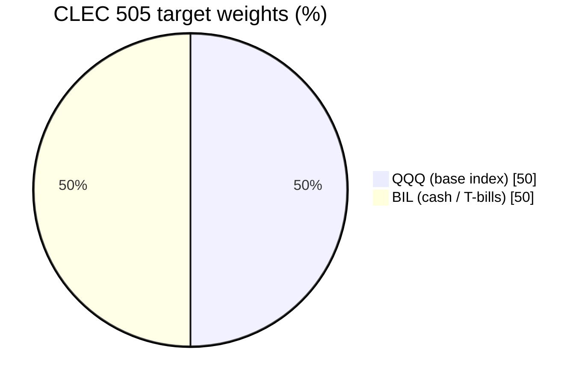
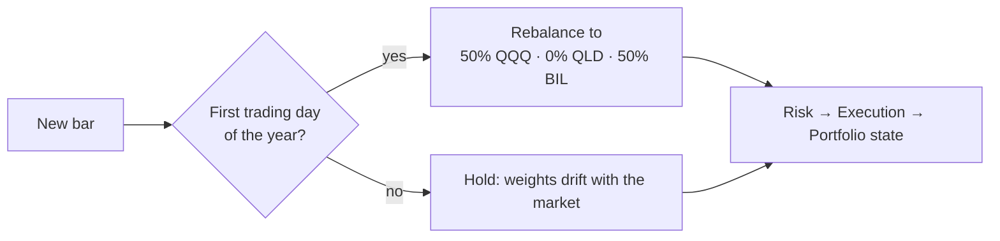
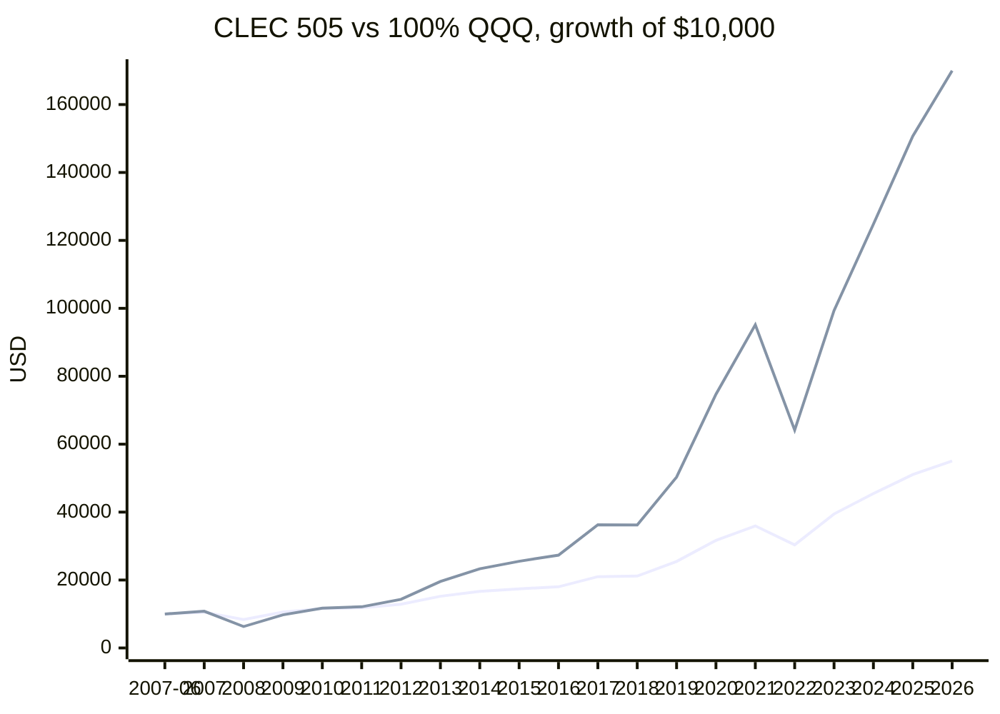
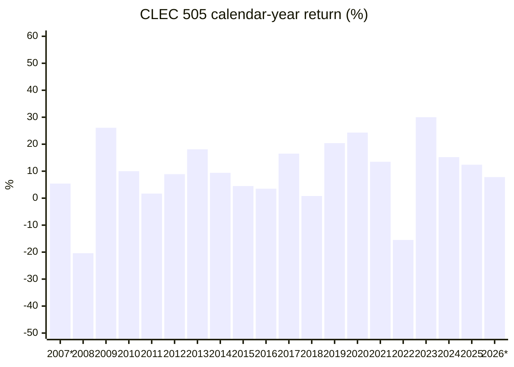
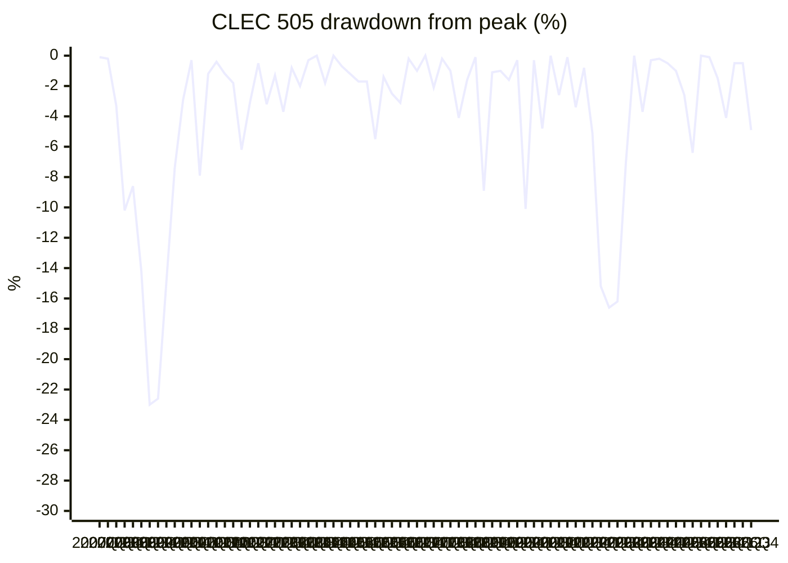

# CLEC 505 backtest / CLEC 505 阵型回测

> **505 = 50% QQQ / 0% QLD / 50% BIL** · beta 0.50 · Elderly / maximum cash / 高龄 / 极致现金
>
> Real adjusted daily closes, **2007-06-01 → 2026-10-30** (19.4 years), rebalanced on the first trading day of each year. Generated by [Quant.Infra.Net](../../README.md); try the mix interactively at [Alpha Wealth Lab · 433 Allocation & Beta Check](https://www.alpha-wealth-lab.com/planner/allocation/).
> 真实复权日线，**2007-06-01 → 2026-10-30**（19.4 年），每年第一个交易日再平衡。由 [Quant.Infra.Net](../../README.md) 生成；可在 [Alpha Wealth Lab · 433 配置与 Beta 体检](https://www.alpha-wealth-lab.com/planner/allocation/) 交互试算。

[← All mixes / 全部阵型](README.md)

## Result vs 100% QQQ / 结果对比 100% QQQ

| Metric / 指标 | CLEC 505 | 100% QQQ |
|---|---:|---:|
| $10,000 grows to / 一万美元变成 | **$55,043** | $169,950 |
| CAGR / 年化收益 | **9.19%** | 15.71% |
| Volatility / 年化波动 | 10.9% | 22.3% |
| Max drawdown / 最大回撤 | **-28.5%** | -53.4% |
| Max drawdown dates / 回撤区间 | 2007-10-31 → 2009-03-09 | 2007-10-31 → 2008-11-20 |
| Recovered on / 回本日 | 2010-04-05 | 2010-12-08 |
| Sharpe (rf = 0) | 0.86 | 0.77 |
| Calmar (CAGR / MaxDD) | 0.32 | 0.29 |
| Best year / 最好年份 | 30.0% (2023) | 54.9% (2023) |
| Worst year / 最差年份 | -20.4% (2008) | -41.7% (2008) |
| Losing years / 亏损年数 | 2 / 20 | 3 / 20 |
| Rebalances · trades · costs / 再平衡 · 成交 · 费用 | 20 · 40 · $419 | buy & hold |

Among the 10 CLEC mixes, 505 ranks **#10 by CAGR** and **#2 by Calmar** (return per unit of drawdown).
在 10 个 CLEC 阵型里，505 的**年化收益排第 10**，**Calmar（收益 / 回撤）排第 2**。

## Allocation / 配置





## Growth of $10,000 (year-end) / 一万美元净值（年末）

Line 1 = CLEC 505, line 2 = 100% QQQ. / 线 1 = CLEC 505，线 2 = 100% QQQ。



## Calendar-year returns / 年度收益



| Year / 年份 | CLEC 505 | 100% QQQ | Difference / 差值 |
|---|---:|---:|---:|
| 2007* | 5.4% | 8.2% | -2.9% |
| 2008 | -20.4% | -41.7% | +21.4% |
| 2009 | 26.1% | 54.7% | -28.6% |
| 2010 | 10.0% | 20.2% | -10.1% |
| 2011 | 1.7% | 3.5% | -1.8% |
| 2012 | 8.9% | 18.1% | -9.3% |
| 2013 | 18.1% | 36.6% | -18.6% |
| 2014 | 9.4% | 19.2% | -9.7% |
| 2015 | 4.5% | 9.4% | -4.9% |
| 2016 | 3.5% | 7.1% | -3.6% |
| 2017 | 16.5% | 32.7% | -16.1% |
| 2018 | 0.8% | -0.1% | +1.0% |
| 2019 | 20.4% | 39.0% | -18.6% |
| 2020 | 24.3% | 48.4% | -24.1% |
| 2021 | 13.5% | 27.4% | -13.9% |
| 2022 | -15.5% | -32.6% | +17.0% |
| 2023 | 30.0% | 54.9% | -24.9% |
| 2024 | 15.2% | 25.6% | -10.4% |
| 2025 | 12.4% | 20.8% | -8.4% |
| 2026* | 7.8% | 12.8% | -5.0% |

`2007*` starts on 2007-06-01; `2026*` ends on 2026-10-30 (partial years). / 带 * 的为不完整年份。

## Drawdown (quarter-end) / 回撤（季末）



## Stress test: real bear markets / 压力测试：真实熊市

Worst peak-to-trough fall of the portfolio inside each window (real QLD prices, so daily-reset decay is included).
每个区间内组合从高点到低点的最大跌幅（用的是 QLD 真实价格，已包含二倍 ETF 每日重置的损耗）。

| Window / 区间 | Dates / 日期 | CLEC 505 | 100% QQQ |
|---|---|---:|---:|
| 2007–09 financial crisis / 2007–09 金融危机 | 2007-10-31 → 2009-03-09 | **-28.5%** | -53.4% |
| 2011 euro-debt scare / 2011 欧债危机 | 2011-07-07 → 2011-10-03 | **-8.4%** | -16.1% |
| 2018 Q4 sell-off / 2018 四季度暴跌 | 2018-10-01 → 2018-12-24 | **-12.0%** | -22.7% |
| 2020 COVID crash / 2020 新冠暴跌 | 2020-02-19 → 2020-03-20 | **-14.8%** | -28.6% |
| 2022 rate-hike bear market / 2022 加息熊市 | 2021-11-19 → 2022-12-28 | **-17.4%** | -35.1% |

On $1,000,000 a repeat of the worst window would mean a paper loss of about **$284,523**. Cash is what lets you hold on, and add, instead of being forced to sell.
以 100 万美元计，重演最差区间约浮亏 **$284,523**。现金的作用是让你扛得住、还能补仓，而不是被迫卖出。

## Method & caveats / 方法与局限

- **Data / 数据:** Yahoo Finance daily *adjusted* closes (dividends and splits reinvested) for QQQ, QLD and BIL, cached in [`docs/assets/_clec_yfinance.json`](../assets/_clec_yfinance.json). BIL (1–3 month T-bills) stands in for the cash sleeve because SGOV / BOXX only start in 2020. / Yahoo 复权日收盘价；现金用 BIL（1–3 个月美债）代替，因为 SGOV / BOXX 2020 年才上市。
- **Leverage / 杠杆:** real QLD prices, so daily-reset decay and fund fees are already in the numbers (unlike a simple "2 × index" estimate). / 使用 QLD 真实价格，已包含每日重置损耗与基金费用。
- **Engine / 引擎:** Quant.Infra.Net bar-by-bar backtester. The strategy stage only sees bars up to the current day; Risk → Execution → Portfolio state are the framework's built-in stages. / 逐 bar 回放，策略只能看到当天及以前的数据。
- **Rebalancing / 再平衡:** back to target weights on the first trading day of each calendar year, filled at that day's close, 5 bps commission + 2 bps slippage per trade. No taxes, no withdrawals, no contributions. / 每年首个交易日按收盘价再平衡，每笔 5 bp 佣金 + 2 bp 滑点；未计税、无提领、无追加投入。
- **Sharpe** uses a 0% risk-free rate. / Sharpe 按 0% 无风险利率计算。
- **Bias / 偏差:** QQQ is a survivor and one of the best-performing indices of 2007–2026; other indices or periods (e.g. 2000–2002, when the Nasdaq-100 fell 83%) can look much worse. / 存在幸存者偏差，2000–2002 纳指 100 跌了 83%，换个区间结果可能差很多。

**Reproduce / 复现：**

```bash
node docs/assets/clec_fetch_data.js
dotnet run --project src/Quant.Infra.Net.Runtime.Console -- ClecDoc
```

> The CLEC mixes come from the published *CLEC Handbook* methodology as implemented by Alpha Wealth Lab; this project is not affiliated with or endorsed by CLEC or its authors. Backtests are not forecasts. **Not investment advice.** / 阵型来自《CLEC 宝典》公开方法论（经 Alpha Wealth Lab 实现）；本项目与 CLEC 及作者无关联、未获背书。回测不代表未来，**不构成投资建议。**
