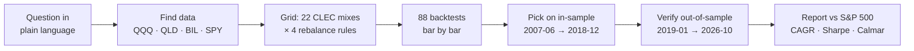
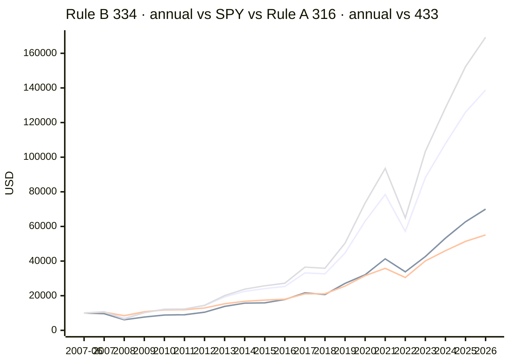
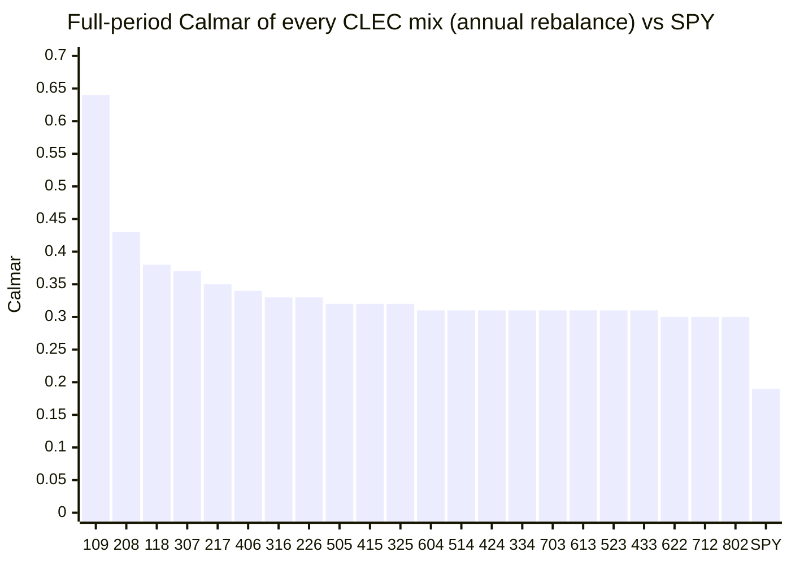

# Finding the best CLEC allocation, honestly / 诚实地寻找最优 CLEC 配置

> **The question / 问题：** *"Within the CLEC rules, which mix of index fund, 2x leveraged ETF and cash, and which rebalancing rule, gives the best return per unit of drawdown? Does it beat the S&P 500 on CAGR, Sharpe **and** Calmar, including on data it has never seen?"*
> *「在 CLEC 规则之内，指数基金、二倍杠杆 ETF、现金怎么配、多久再平衡，单位回撤的收益最高？它在年化收益、夏普**和**卡玛比率上能否全面跑赢标普 500？换成它没见过的数据还成立吗？」*
>
> Real adjusted daily closes of QQQ, QLD, BIL and SPY, **2007-06-01 → 2026-10-30**. Run with [Quant.Infra.Net](../../README.md)'s bar-by-bar backtester; the mixes come from [Alpha Wealth Lab · 433 Allocation & Beta Check](https://www.alpha-wealth-lab.com/planner/allocation/).
> 数据：QQQ、QLD、BIL、SPY 真实复权日线，**2007-06-01 → 2026-10-30**。用 [Quant.Infra.Net](../../README.md) 的逐 bar 回测引擎完成；阵型来自 [Alpha Wealth Lab · 433 配置与 Beta 体检](https://www.alpha-wealth-lab.com/planner/allocation/)。

[← All mixes / 全部阵型](README.md)

## The research loop / 研究流程



## Search space / 搜索空间

- **Mixes / 阵型:** every 10%-step split of QQQ / QLD / BIL that obeys the CLEC rules: cash ≥ 20%, leveraged ≤ base, leveraged ≤ cash → **22 mixes**. (442 breaks the "leveraged ≤ cash" rule and is reserved for under-30 savers, so it is outside the search.) / 所有满足 CLEC 规则（现金 ≥ 20%、杠杆 ≤ 原型、杠杆 ≤ 现金）的 10% 步长组合（442 违反「杠杆 ≤ 现金」，只适用于 30 岁以下，不在搜索范围内）。
- **Rebalance rules / 再平衡规则:** annual, quarterly, monthly, or whenever a sleeve drifts more than ±5 points from target (checked daily). / 每年、每季、每月，或任一部位偏离目标超过 ±5 个百分点时（每日检查）。
- **Costs / 成本:** 5 bps commission + 2 bps slippage on every trade. / 每笔 5 bp 佣金 + 2 bp 滑点。

**Two selection rules / 两条选择规则：**

- **Rule A (declared first) / 规则 A（最先定下）:** among the candidates that beat SPY on CAGR, Sharpe and Calmar *in-sample*, take the one with the highest in-sample Calmar. / 在样本内三项全胜 SPY 的候选里，取样本内卡玛比率最高者。
- **Rule B (added after Rule A failed; see below) / 规则 B（规则 A 失败后补充，见下文）:** take the candidate whose *weakest* in-sample ratio vs SPY (CAGR ÷ SPY CAGR, Sharpe ÷ SPY Sharpe, Calmar ÷ SPY Calmar) is the highest. It aims directly at the goal "beat the S&P 500 on all three". / 取样本内三项相对 SPY 比值中「最弱一项」最高的候选，直接对准「三项全胜标普」的目标。

57 of 88 candidates beat SPY on all three metrics in-sample. / 88 个候选中有 57 个在样本内三项全胜 SPY。

## Results / 结果

| Period / 区间 | Metric / 指标 | Rule A: **316 · annual** | Rule B: **334 · annual** | SPY (S&P 500) |
|---|---|---:|---:|---:|
| In-sample (picked here) / 样本内（在此选参）<br/>2007-06-01 → 2018-12-31 | CAGR | 6.68% ✅ | 10.76% ✅ | 6.47% |
| | Sharpe | 0.70 ✅ | 0.66 ✅ | 0.41 |
| | Calmar | 0.24 ✅ | 0.23 ✅ | 0.12 |
| | Max drawdown / 最大回撤 | -27.8% | -46.8% | -55.2% |
| **Out-of-sample / 样本外**<br/>2019-01-02 → 2026-10-30 | CAGR | 13.02% ❌ | 20.30% ✅ | 16.87% |
| | Sharpe | 1.10 ✅ | 0.99 ✅ | 0.91 |
| | Calmar | 0.78 ✅ | 0.69 ✅ | 0.50 |
| | Max drawdown / 最大回撤 | -16.7% | -29.5% | -33.7% |
| Full period / 全区间<br/>2007-06-01 → 2026-10-30 | CAGR | 9.19% ❌ | 14.51% ✅ | 10.55% |
| | Sharpe | 0.87 ✅ | 0.81 ✅ | 0.61 |
| | Calmar | 0.33 ✅ | 0.31 ✅ | 0.19 |
| | Max drawdown / 最大回撤 | -27.8% | -46.8% | -55.2% |
| | $10,000 → | $55,105 | $138,803 | $70,008 |

Rule A pick: **30% QQQ / 10% QLD / 60% BIL** (beta 0.50). Rule B pick: **30% QQQ / 30% QLD / 40% BIL** (beta 0.90), rebalanced annual. ✅ / ❌ = beats / does not beat SPY.

**What happened / 发生了什么：**

- **Rule A failed out of sample.** Maximizing Calmar alone drifts toward cash-heavy, low-beta mixes. They looked great through 2008 but could not keep up with a strong 2019–2026 bull market on CAGR (13.0% vs 16.9%). This is exactly the kind of mistake the out-of-sample check exists to catch. / **规则 A 在样本外失败了。** 只追求卡玛比率，会把选择推向现金多、Beta 低的阵型：熬过 2008 很漂亮，但在 2019–2026 的强牛市里年化收益跟不上（13.0% 对 16.9%）。样本外检验存在的意义，正是抓住这类错误。
- **Rule B's pick beat SPY on CAGR, Sharpe and Calmar in-sample, out-of-sample and over the full period.** Because Rule B was written *after* seeing Rule A's out-of-sample result, its out-of-sample evidence is weaker than a truly blind test; treat it as a strong hint, not proof. / **规则 B 的选择在样本内、样本外、全区间都三项全胜 SPY。** 但规则 B 是在看到规则 A 的样本外结果*之后*才写的，所以它的样本外证据弱于真正的盲测：请把它当作强烈提示，而不是证明。

### Growth of $10,000 (year-end) / 一万美元净值（年末）

Line 1 = Rule B (334 · annual), line 2 = SPY (S&P 500), line 3 = Rule A (316 · annual), line 4 = classic 433 · annual. Out-of-sample starts in 2019. / 线 1 = 规则 B，线 2 = SPY，线 3 = 规则 A，线 4 = 经典 433；2019 年起为样本外。



### Every candidate that beat SPY on all three metrics out-of-sample (25 of 88) / 样本外三项全胜 SPY 的全部候选

| Mix · rule / 阵型 · 规则 | Beta | OOS CAGR | OOS Sharpe | OOS Calmar | Full CAGR | Full Sharpe | Full Calmar | Full max DD |
|---|---:|---:|---:|---:|---:|---:|---:|---:|
| 424 · annual | 0.8 | 18.6% | 1.00 | 0.70 | 13.3% | 0.81 | 0.31 | -42.7% |
| 613 · annual | 0.8 | 18.5% | 1.00 | 0.68 | 13.3% | 0.81 | 0.31 | -43.3% |
| 802 · annual | 0.8 | 18.4% | 0.99 | 0.66 | 13.2% | 0.79 | 0.30 | -43.9% |
| **334 · annual** | 0.9 | 20.3% | 0.99 | 0.69 | 14.5% | 0.81 | 0.31 | -46.8% |
| 523 · annual | 0.9 | 20.2% | 0.98 | 0.67 | 14.5% | 0.80 | 0.31 | -47.4% |
| 712 · annual | 0.9 | 20.2% | 0.97 | 0.65 | 14.5% | 0.79 | 0.30 | -48.0% |
| 802 · ±5pt band | 0.8 | 18.3% | 0.97 | 0.62 | 13.2% | 0.78 | 0.30 | -44.8% |
| 433 · annual | 1.0 | 21.9% | 0.97 | 0.66 | 15.7% | 0.79 | 0.31 | -51.3% |
| 622 · annual | 1.0 | 21.9% | 0.96 | 0.65 | 15.7% | 0.78 | 0.30 | -51.9% |
| 424 · ±5pt band | 0.8 | 17.8% | 0.96 | 0.62 | 12.7% | 0.76 | 0.28 | -45.1% |
| 802 · quarterly | 0.8 | 17.8% | 0.96 | 0.61 | 12.7% | 0.76 | 0.28 | -44.8% |
| 613 · ±5pt band | 0.8 | 17.9% | 0.96 | 0.62 | 12.8% | 0.76 | 0.28 | -45.3% |
| 613 · quarterly | 0.8 | 17.7% | 0.96 | 0.60 | 12.4% | 0.76 | 0.28 | -45.2% |
| 622 · ±5pt band | 1.0 | 21.8% | 0.95 | 0.62 | 15.6% | 0.76 | 0.29 | -53.7% |
| 424 · quarterly | 0.8 | 17.5% | 0.95 | 0.59 | 12.2% | 0.75 | 0.27 | -45.6% |
| 523 · ±5pt band | 0.9 | 19.7% | 0.94 | 0.62 | 14.0% | 0.75 | 0.28 | -50.0% |
| 712 · quarterly | 0.9 | 19.5% | 0.94 | 0.60 | 13.8% | 0.75 | 0.28 | -49.6% |
| 523 · quarterly | 0.9 | 19.3% | 0.94 | 0.59 | 13.5% | 0.75 | 0.27 | -49.9% |
| 712 · ±5pt band | 0.9 | 19.7% | 0.94 | 0.61 | 14.3% | 0.76 | 0.29 | -49.3% |
| 334 · quarterly | 0.9 | 19.1% | 0.93 | 0.58 | 13.3% | 0.74 | 0.26 | -50.3% |
| 334 · ±5pt band | 0.9 | 19.3% | 0.93 | 0.60 | 13.7% | 0.74 | 0.27 | -50.7% |
| 622 · quarterly | 1.0 | 21.0% | 0.93 | 0.59 | 14.9% | 0.75 | 0.28 | -53.9% |
| 433 · quarterly | 1.0 | 20.8% | 0.92 | 0.58 | 14.6% | 0.74 | 0.27 | -54.3% |
| 433 · ±5pt band | 1.0 | 20.9% | 0.91 | 0.57 | 14.9% | 0.74 | 0.28 | -54.3% |
| 802 · monthly | 0.8 | 16.9% | 0.92 | 0.57 | 11.9% | 0.72 | 0.26 | -45.5% |
| *SPY (S&P 500)* | 1.0 | 16.9% | 0.91 | 0.50 | 10.5% | 0.61 | 0.19 | -55.2% |

## Is it overfit? Robustness checks / 是否过拟合？稳健性检验

- **Rank stability / 排名稳定性:** Spearman correlation between in-sample and out-of-sample Calmar across all 88 candidates = **0.79**. (1 = the in-sample ranking predicts the future ranking perfectly; 0 = no relation.) / 全部候选样本内与样本外卡玛排名的 Spearman 相关系数为 **0.79**（1 = 完全一致，0 = 毫无关系）。
- **Breadth / 广度:** **25 of 88** candidates beat SPY on all three metrics out-of-sample; **44 of 88** over the full period. If only one magic setting worked, that would be a red flag. / 样本外有 **25/88** 个候选三项全胜 SPY，全区间 **44/88**。如果只有一个「神奇参数」有效，那才是危险信号。
- **Pick's out-of-sample rank / 选中配置的样本外排名:** #12 of 88 by Calmar. / 按卡玛比率排第 12。

**Top 10 in-sample, and how they did afterwards / 样本内前 10 名及其样本外表现：**

| # IS | Mix · rule / 阵型 · 规则 | Beta | IS Calmar | IS CAGR | OOS Calmar | OOS CAGR | OOS Sharpe | OOS rank | OOS beats SPY on all 3? |
|---:|---|---:|---:|---:|---:|---:|---:|---:|:---:|
| 1 | 109 · ±5pt band | 0.1 | 0.45 | 1.9% | 1.12 | 4.7% | 1.81 | 3 | ❌ |
| 2 | 109 · annual | 0.1 | 0.38 | 1.8% | 1.44 | 4.8% | 1.95 | 1 | ❌ |
| 3 | 208 · annual | 0.2 | 0.29 | 3.1% | 1.04 | 6.9% | 1.43 | 4 | ❌ |
| 4 | 208 · ±5pt band | 0.2 | 0.28 | 3.1% | 0.81 | 6.6% | 1.35 | 10 | ❌ |
| 5 | 118 · annual | 0.3 | 0.27 | 4.3% | 0.95 | 9.0% | 1.24 | 5 | ❌ |
| 6 | 109 · quarterly | 0.1 | 0.26 | 1.4% | 1.15 | 4.3% | 1.80 | 2 | ❌ |
| 7 | 307 · annual | 0.3 | 0.26 | 4.3% | 0.88 | 9.0% | 1.25 | 6 | ❌ |
| 8 | 217 · annual | 0.4 | 0.25 | 5.5% | 0.84 | 11.1% | 1.16 | 7 | ❌ |
| 9 | 406 · annual | 0.4 | 0.24 | 5.5% | 0.80 | 11.0% | 1.15 | 11 | ❌ |
| 10 | **316 · annual** | 0.5 | 0.24 | 6.7% | 0.78 | 13.0% | 1.10 | 12 | ❌ |
| | *SPY (S&P 500)* | 1.0 | 0.12 | 6.5% | 0.50 | 16.9% | 0.91 | | |

**Does the rebalance rule matter? (median across all mixes) / 再平衡规则重要吗？（所有阵型的中位数）**

| Rule / 规则 | Full CAGR | Full Sharpe | Full Calmar | OOS Calmar | Median rebalances / 再平衡次数 |
|---|---:|---:|---:|---:|---:|
| annual / 每年 | 11.3% | 0.83 | 0.32 | 0.72 | 20 |
| quarterly / 每季 | 10.4% | 0.77 | 0.28 | 0.62 | 79 |
| monthly / 每月 | 9.6% | 0.72 | 0.25 | 0.56 | 233 |
| ±5pt band / 偏离 ±5 个百分点 | 10.8% | 0.78 | 0.29 | 0.63 | 27 |



## What this does and does not prove / 这证明了什么，没证明什么

- ✅ **It proves the workflow**: ask a question, pull free data, run dozens of realistic backtests, pick with a rule fixed in advance, and check the pick on data it never saw, all reproducible from one command. / ✅ **它证明了工作流**：提出问题 → 拉免费数据 → 跑几十次真实回测 → 用事先定死的规则选参 → 在没见过的数据上检验，一条命令即可复现。
- ❌ **It does not prove the future**: 2007–2026 was one of the best periods in history for the Nasdaq-100. The 2000–2002 bust (Nasdaq-100 −83%) is not in this data because QLD and BIL did not exist yet; a 2x sleeve through that would have been close to wiped out. Market style can switch at any time. / ❌ **它不能证明未来**：2007–2026 是纳指 100 史上最好的时期之一。2000–2002 年泡沫破裂（纳指 100 跌 83%）不在数据里，因为当时 QLD 和 BIL 还不存在；二倍杠杆部位在那轮下跌中几乎会归零。市场风格随时可能切换。
- The method, not the number, is the takeaway: re-run it on your own symbols, period and rules. / 值得带走的是方法，而不是这个数字：换成你自己的标的、区间和规则再跑一次。

## Method & caveats / 方法与局限

- **Data / 数据:** Yahoo Finance daily *adjusted* closes (dividends and splits reinvested) for QQQ, QLD, BIL and SPY, cached in [`docs/assets/_clec_yfinance.json`](../assets/_clec_yfinance.json). BIL (1–3 month T-bills) stands in for the cash sleeve because SGOV / BOXX only start in 2020; SPY is the S&P 500 benchmark with dividends. / Yahoo 复权日收盘价；现金用 BIL（1–3 个月美债）代替，因为 SGOV / BOXX 2020 年才上市；SPY 为含股息的标普 500 基准。
- **Leverage / 杠杆:** real QLD prices, so daily-reset decay and fund fees are already in the numbers (unlike a simple "2 × index" estimate). / 使用 QLD 真实价格，已包含每日重置损耗与基金费用。
- **Engine / 引擎:** Quant.Infra.Net bar-by-bar backtester. The strategy stage only sees bars up to the current day; Risk → Execution → Portfolio state are the framework's built-in stages. / 逐 bar 回放，策略只能看到当天及以前的数据。
- **Trading / 交易:** fills at the rebalance day's close, 5 bps commission + 2 bps slippage per trade. No taxes, no withdrawals, no contributions. / 按再平衡当日收盘价成交，每笔 5 bp 佣金 + 2 bp 滑点；未计税、无提领、无追加投入。
- **Metrics / 指标:** CAGR from first to last close; Sharpe = mean / stdev of daily returns × √252 with a 0% risk-free rate; Calmar = CAGR / |max drawdown|. / Sharpe 用日收益、√252 年化、无风险利率 0；Calmar = 年化收益 / 最大回撤绝对值。
- **Bias / 偏差:** QQQ is a survivor and one of the best-performing indices of 2007–2026; other indices or periods (e.g. 2000–2002, when the Nasdaq-100 fell 83%) can look much worse. / 存在幸存者偏差，2000–2002 纳指 100 跌了 83%，换个区间结果可能差很多。

**Reproduce / 复现：**

```bash
node docs/assets/clec_fetch_data.js
dotnet run --project src/Quant.Infra.Net.Runtime.Console -- ClecOptimize
```

> The CLEC mixes come from the published *CLEC Handbook* methodology (James) as implemented by Alpha Wealth Lab; this project is not affiliated with or endorsed by CLEC or its authors. Backtests are not forecasts; market style can switch at any time and nobody can predict the future. **Not investment advice.** / 阵型来自《CLEC 宝典》（James 老师）公开方法论，经 Alpha Wealth Lab 实现；本项目与 CLEC 及作者无关联、未获背书。回测不代表未来，市场风格随时可能切换，没有人能预测未来。**不构成投资建议。**
