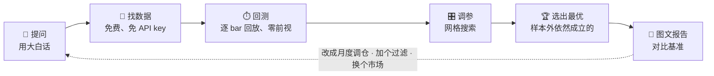
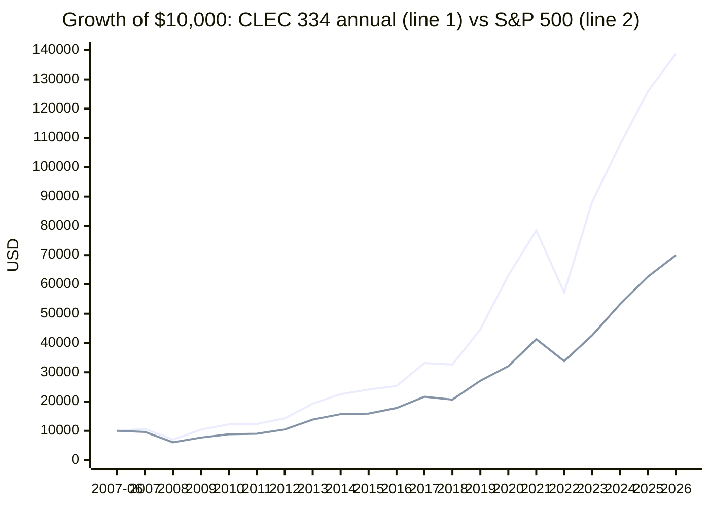
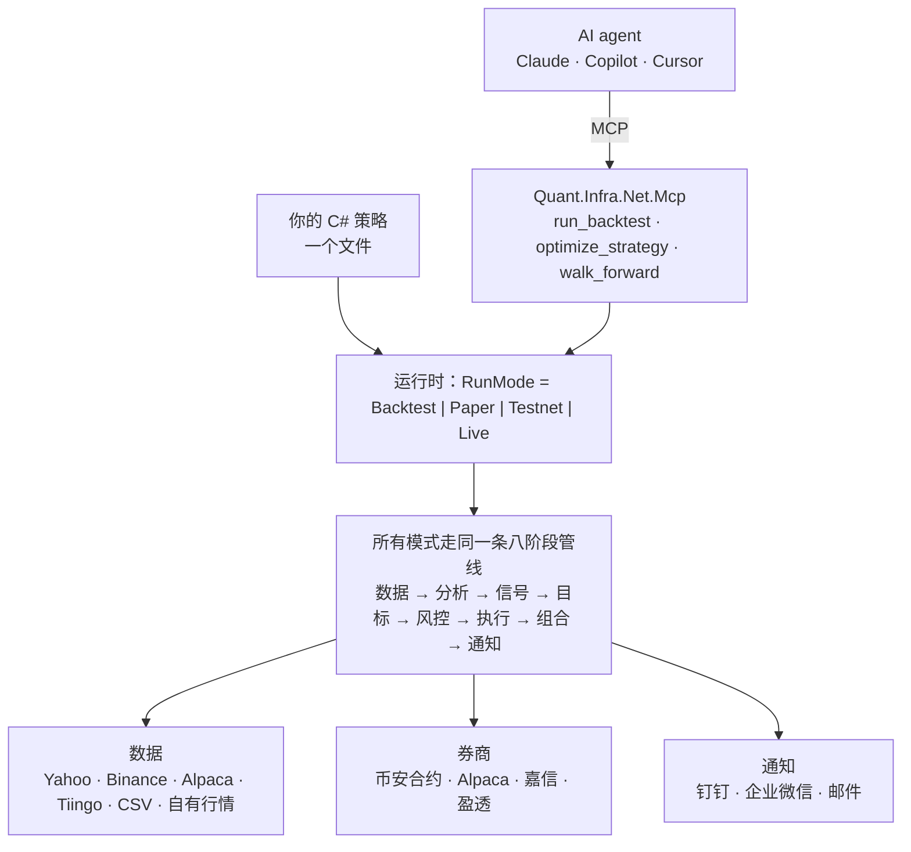
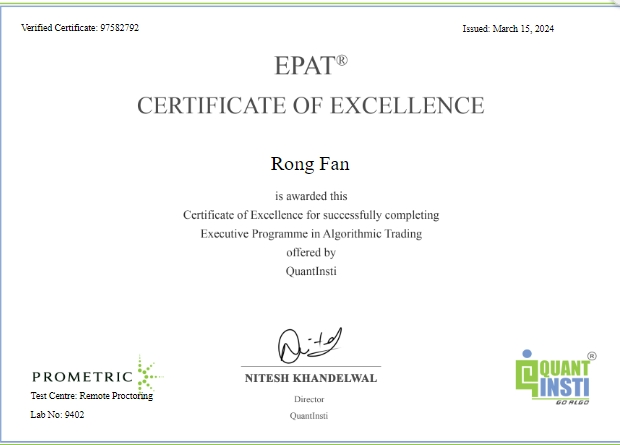

# Quant.Infra.Net

[](https://github.com/memoryfraction/Quant.Infra.Net/actions/workflows/ci.yml)  [](https://dotnet.microsoft.com/download/dotnet/8.0)  [](https://www.nuget.org/packages/Quant.Infra.Net.Mcp)  [](https://www.nuget.org/packages/Quant.Infra.Net.Runtime)  [](../LICENSE)

🌐 [English](readme-en.md) · **中文** · [首页](../README.md)

## 用一句大白话提出交易想法，拿回数据、回测、调好的参数，和一个诚实的答案。

**Quant.Infra.Net** 是一套免费开源（MIT）的 .NET 量化框架，内置 **MCP server**。你只需要把想法告诉 Claude、Copilot 或 Cursor：AI 会自己找免费行情、跑真实回测、调参数、再用它没见过的数据检验，最后交给你一份带图表的报告。准备上实盘时，同一份策略用 C# 直接对接币安、Alpaca、嘉信、盈透。

> ⭐ 如果它帮你省了时间，请**给仓库点个 Star**，这是别人找到它的方式。

---

## ✨ 一个闭环，五个步骤



| 步骤 | 发生了什么 | 内置能力 |
|---|---|---|
| 💬 **自然语言** | 你说话，AI agent 调工具。不写代码，不开 notebook。 | 面向 Claude Desktop / Claude Code / Copilot / Cursor 的 MCP server，外加引导流程（`quickstart`、`strategy_research`、`regime_check`） |
| 🔎 **找数据** | agent 自己选数据源，拉历史数据和预热数据，并缓存到本地。 | `list_data_sources`、`fetch_ohlcv`。**Yahoo**（美股、港股、A 股、ETF、指数、外汇、期货，已复权）和 **Binance**（加密货币）免 key；另有 Tiingo、本地 CSV |
| ⏱️ **回测** | 逐 bar 回放，按**下一根 K 线开盘价**成交，计入佣金和滑点。 | `run_backtest` 给出与买入持有的对比、市场状态拆解、年度/月度收益、风险提示，以及一份自包含的 **HTML 报告** |
| 🎛️ **调参** | 对策略参数做网格搜索。 | `optimize_strategy` 预留**样本外**区间，自动识别过拟合 |
| 🏆 **找出最优参数和策略** | 只相信*活下来*的参数，不相信样本内的峰值。 | `walk_forward` 滚动重新优化、拼接样本外结果；策略包括 `MaCross`、`MeanReversion`、`PairTradingZScore`、`MultiFactor` |

闭环背后是一整套 C# 技术栈：**同一个策略文件跑回测、模拟、测试网、实盘**，数据源、券商、通知都靠改配置切换，不用改代码。

---

## 🏆 实证：一个 CLEC（James 老师）配置，在年化收益、夏普、卡玛比率上全面跑赢标普 500

> **问题：** *「《CLEC 宝典》把资金分成指数基金、二倍杠杆 ETF、现金三份（著名的 433）。在它的规则之内，哪种比例、多久再平衡一次最好？它能否在年化收益、夏普**和**卡玛比率上全面跑赢标普 500？换成它没见过的年份还成立吗？」*

**工具做了什么：** 拉取 19 年免费的复权日线（QQQ、QLD、BIL、SPY，2007-06 → 2026-10，含 2008、2020、2022），穷举所有符合 CLEC 规则的阵型（现金 ≥ 20%、杠杆 ≤ 原型、杠杆 ≤ 现金）× 4 种再平衡规则，共 **88 次含交易成本的逐 bar 回测**。只用 **2007–2018** 的数据做选择，再用 **2019–2026** 检验。

**答案：334 = 30% QQQ / 30% QLD / 40% 现金，每年再平衡一次。**

| | **CLEC 334 · 每年** | 标普 500（SPY） |
|---|---:|---:|
| 年化收益（全区间） | **14.51%** ✅ | 10.55% |
| 夏普（全区间） | **0.81** ✅ | 0.61 |
| 卡玛比率（全区间） | **0.31** ✅ | 0.19 |
| 最大回撤 | **−46.8%** | −55.2% |
| 年化 / 夏普 / 卡玛（*样本外 2019–2026*） | **20.3% / 0.99 / 0.69** ✅ | 16.9% / 0.91 / 0.50 |
| 2007 年 6 月的 1 万美元 → 2026 年 10 月 | **$138,803** | $70,008 |



线 1 = CLEC 334（每年再平衡），线 2 = 标普 500。

**多数回测不会告诉你的部分：**

- ❌ **第一条选择规则失败了，而工具抓住了它。** 只挑样本内卡玛比率最高的，会选中现金很多的 316：2018 年以前跑赢 SPY，之后年化收益却落后（13.0% 对 16.9%）。样本外检验存在的意义，正在于此。
- ⚠️ **胜出的规则（最大化三项相对 SPY 比值中最弱的一项）是在那次失败之后才写的**，所以它的样本外结果是强烈提示，而不是盲测证明。
- ✅ **不是某个「神奇参数」。** 88 个候选中有 25 个在样本外三项全胜 SPY，Beta 全部在 0.8–1.0 之间，经典 433 · 每年也在其中；每年再平衡优于每季、每月和偏离阈值再平衡。

📊 完整研究（全部表格与图表）：[寻优研究](backtests/clec-optimization.md) · 每个阵型一份报告：[10 个 CLEC 阵型](backtests/README.md) · 交互试算任意阵型：[Alpha Wealth Lab · 433 配置](https://www.alpha-wealth-lab.com/planner/allocation/)

<sub>本研究用框架的 C# 回测引擎完成（`dotnet run --project src/Quant.Infra.Net.Runtime.Console -- ClecOptimize`），采用与自然语言调用 `optimize_strategy`、`walk_forward` 时相同的样本内 / 样本外纪律。把固定权重的多资产配置做成 MCP 内置策略已在路线图中。CLEC 方法归原作者（James 老师，《CLEC 宝典》）所有，本项目与其无关联、未获背书。这是过去的结果，且纳指 100 是这段时间最强的指数之一，不代表未来。</sub>

---

## 🌊 市场风格随时会切换，没有人能预测未来

一个连续有效十年的策略，下个月就可能失效：成长让位于价值，低利率变成高利率，平稳变成危机。**没有任何回测、优化器或个人能告诉你市场接下来会怎么走。** 本项目不会假装能做到。

它给你的是**看清并应对风格切换的方法**，**不是**一个号称永远有效的「现成解决方案」。

| 方法 | 回答什么问题 | 工具 |
|---|---|---|
| **诊断** | 优势*在什么时候*消失的？按市场状态（牛/熊 × 平稳/动荡）拆解收益，外加滚动 6 个月夏普。 | 每份 `run_backtest` 报告 |
| **验证** | 最优参数是真的，还是样本内的运气？ | `optimize_strategy`（样本外检验） |
| **自适应** | 如果持续滚动调参，真实能拿到多少？ | `walk_forward` |
| **防御** | 市场转向时，策略能不能先退一步？市场状态过滤、绝对动量过滤、多因子混合。 | `MultiFactor` 参数 |
| **压力测试** | 2008、2020、2022 年会亏多少？你扛得住吗？ | 每份报告里的压力测试表 |

拿到答案后怎么做，由你决定。你的风险偏好、收入、税务和人生阶段，不在任何数据集里。

---

## 🚀 快速上手

### 路径 A：零代码，和 AI agent 对话

需要 [.NET 8+ SDK](https://dotnet.microsoft.com/download)。

```bash
dotnet tool install -g Quant.Infra.Net.Mcp
```

Claude Desktop（`claude_desktop_config.json`）：

```json
{ "mcpServers": { "quant-infra-net": { "command": "quant-infra-mcp" } } }
```

Claude Code：

```bash
claude mcp add quant-infra-net -- quant-infra-mcp
```

然后直接问：

> *「QQQ 从 2010 年起用多少日均线最好？样本外还成立吗？」*
>
> *「在 SPY、QQQ、IWM、EFA、EEM、TLT、GLD、DBC 之间轮动，从 2008 年开始。每月持有动量最强的 3 只；SPY 跌破 200 日均线时切到 SHY。和 SPY 对比，给我报告。」*
>
> *「这个策略是不是只在牛市有效？做一次滚动前推检验。」*

📖 完整指南：[AI Agent 接入](manual/mcp-server-ch.md)。MCP server 只读，**永不实盘下单**。

### 路径 B：C# 开发者

```bash
git clone https://github.com/memoryfraction/Quant.Infra.Net.git
```

```bash
cd Quant.Infra.Net
```

```bash
dotnet run --project src/Quant.Infra.Net.Runtime.Console -- QqqmDoc
```

大约一分钟，离线跑完一个真实的 QQQM 逆向 MA200 回测。然后复现上面的 CLEC 案例：

```bash
dotnet run --project src/Quant.Infra.Net.Runtime.Console -- ClecOptimize
```

在自己的项目里引入整套技术栈：

```bash
dotnet add package Quant.Infra.Net.Runtime
```

`Backtest` / `Paper` / `Testnet` / `Live` 用一个配置值（`Runtime:RunMode`）切换。新增策略只需往项目里放一个类，见[任务导向深度指南](manual/README-ch.md)和 [`ExampleCustomStrategy.cs`](../src/Quant.Infra.Net.Runtime.Console/Strategies/ExampleCustomStrategy.cs)。

---

## 📦 NuGet 包

| 包 | 版本 | 提供什么 |
|---|---|---|
| [`Quant.Infra.Net.Mcp`](https://www.nuget.org/packages/Quant.Infra.Net.Mcp) | 1.6.0 | .NET 工具 / MCP server：自然语言回测、调参、滚动前推、图文报告、免费数据 |
| [`Quant.Infra.Net.Runtime`](https://www.nuget.org/packages/Quant.Infra.Net.Runtime) | 1.6.0 | 一个 `RunMode` 开关（回测/模拟/测试网/实盘），一个文件一个策略。**推荐入口** |
| [`Quant.Infra.Net.Backtest`](https://www.nuget.org/packages/Quant.Infra.Net.Backtest) | 1.6.0 | 事件驱动、逐 bar 回测引擎，带前视防护和参数扫描 |
| [`Quant.Infra.Net.Orchestration`](https://www.nuget.org/packages/Quant.Infra.Net.Orchestration) | 1.6.0 | 八阶段管线：数据 → 分析 → 信号 → 目标仓位 → 风控 → 执行 → 组合 → 通知 |
| [`Quant.Infra.Net`](https://www.nuget.org/packages/Quant.Infra.Net) | 1.5.3 | 核心库：数据源、券商（币安合约、Alpaca、嘉信、盈透）、统计（ADF、OLS、Z-score、协整）、通知（钉钉、企业微信、邮件） |

---

## 🧱 架构



所有模式都走同一条管线，所以你回测的就是你上线的。

---

## 📚 文档

| 文档 | 内容 |
|---|---|
| [CLEC 回测](backtests/README.md) · [寻优研究](backtests/clec-optimization.md) | 10 个配置阵型对比标普 500，每个阵型一份报告，外加样本外寻优 |
| [AI Agent 接入](manual/mcp-server-ch.md) | 安装、客户端配置、每个工具和引导流程、数据源、安全边界 |
| [完整图文教程](CompleteWalkthrough-ch.md) | 从几行代码到真实 QQQM 回测 |
| [统一运行时使用说明](UnifiedRuntimeQuickStart-ch.md) | 一个配置值切换回测/模拟；替换数据源、策略、凭据 |
| [回测引擎使用说明](BacktestQuickStart-ch.md) | 逐 bar 引擎、前视防护、指标、参数扫描 |
| [任务导向深度指南](manual/README-ch.md) | 配置参考、编写策略、自定义风控/数据源/券商、部署、FAQ |
| [GitHub Pages](https://memoryfraction.github.io/Quant.Infra.Net/) | 文档站点 |

---

## 👤 关于作者

由 **Rong Fan**（[@memoryfraction](https://github.com/memoryfraction)）开发和维护，.NET 工程师、量化开发者。

- 🎓 QuantInsti **EPAT® 算法交易优秀证书**（2024）。毕业项目：[加密永续合约配对交易](https://blog.quantinsti.com/crypto-perpetual-contract-pair-trading-project-rong-fan/)
- 📘 电子书《区块链量化投资实战》作者（[Amazon](https://www.amazon.com/dp/B0D7W89ZQD) · [小红书笔记](https://www.xiaohongshu.com/discovery/item/6a9366b4000000002102fbff)）
- 🧮 运营 [Alpha Wealth Lab](https://www.alpha-wealth-lab.com/planner/)：免费的财富规划计算器（433 配置、质押寿命、聪明再平衡、退休提领）
- 🔧 其他开源项目：[LLSDA](https://github.com/memoryfraction/LLSDA-Lightning-Location-System-Data-Analyzer)（闪电定位数据分析，被 TechRxiv 预印本引用）· [HealthData-Interoperability-Csharp](https://github.com/memoryfraction/HealthData-Interoperability-Csharp)（FHIR R4/R5 引擎）



---

## 🤝 反馈与合作

代码以 MIT 许可免费开放，可商用。你的反馈决定路线图。

| 我想… | 前往 |
|---|---|
| 🐞 报 Bug，或 ✨ 需要新功能、券商、数据源 | [提交 Issue](https://github.com/memoryfraction/Quant.Infra.Net/issues/new) |
| 💡 使用疑问、想法交流 | [发起讨论](https://github.com/memoryfraction/Quant.Infra.Net/discussions) |
| 🔒 报告安全问题 | [SECURITY.md](../SECURITY.md)（请勿公开提交） |
| 💼 咨询、券商集成、定制开发 | [预约 30 分钟通话](https://calendly.com/rex-fan18/30min) · [rex.fan18@gmail.com](mailto:rex.fan18@gmail.com) · [服务与报价](Commercial.md) |

---

## ⚖️ 免责声明

Quant.Infra.Net 是研究与工程工具，**本项目任何内容都不构成投资建议**。回测描述的是过去，不能预测未来；市场风格随时可能切换，曾经有效的策略可能突然失效。免费数据源没有 SLA。你的决策与盈亏由你自己负责。文中引用的策略方法（如 CLEC 配置阵型）归原作者所有，本项目与其无关联、未获其背书。完整条款见[免责声明](DISCLAIMER.md)。
