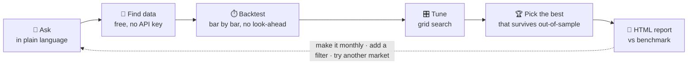
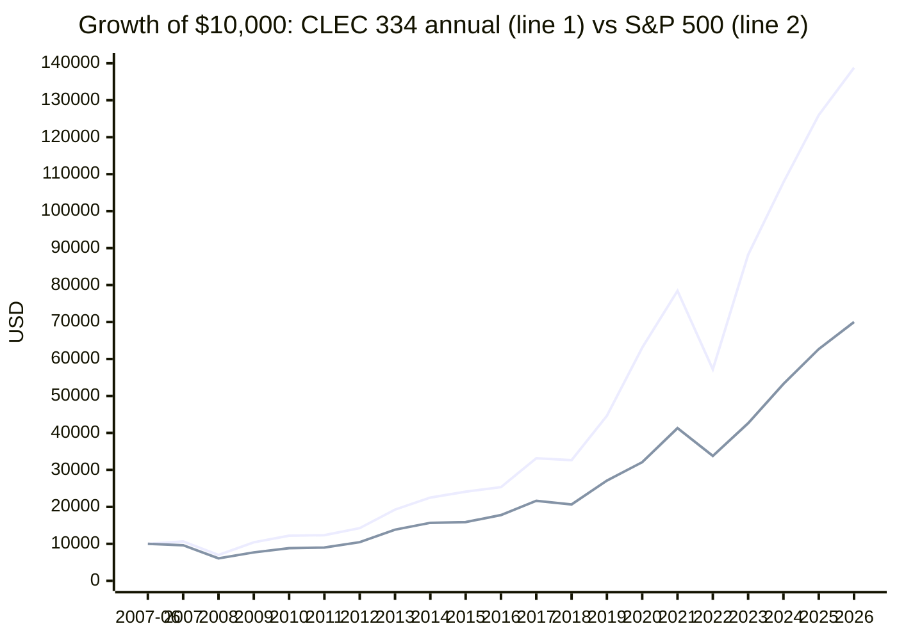
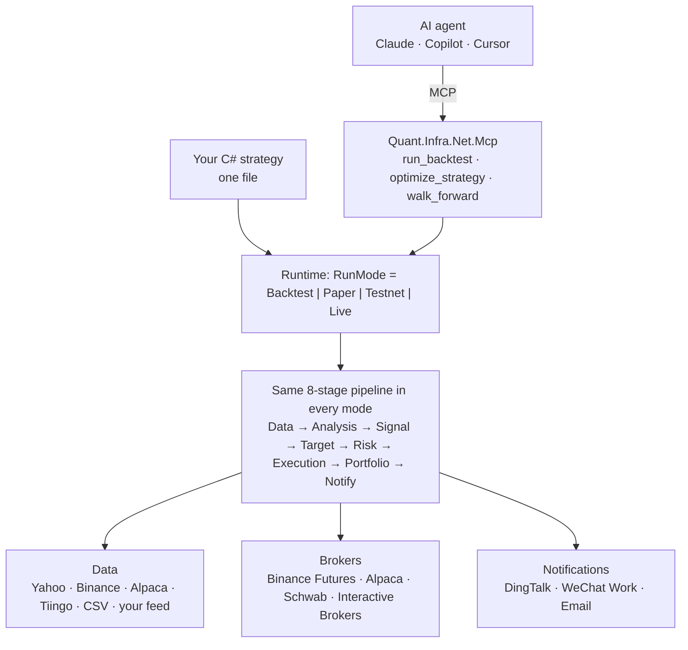
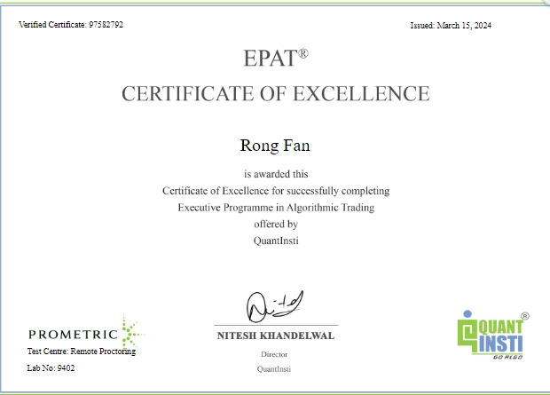

# Quant.Infra.Net

[](https://github.com/memoryfraction/Quant.Infra.Net/actions/workflows/ci.yml)  [](https://dotnet.microsoft.com/download/dotnet/8.0)  [](https://www.nuget.org/packages/Quant.Infra.Net.Mcp)  [](https://www.nuget.org/packages/Quant.Infra.Net.Runtime)  [](../LICENSE)

🌐 **English** · [中文](readme-ch.md) · [Home](../README.md)

## Ask a trading question in plain language. Get the data, the backtest, the tuned parameters, and an honest answer.

**Quant.Infra.Net** is a free, open-source (MIT) quant framework for .NET with a built-in **MCP server**. Describe an idea to Claude, Copilot or Cursor. The agent finds free market data, runs realistic backtests, tunes the parameters, checks them on data they've never seen, and hands back a report with charts. When you're ready to go live, the same strategy runs in C# against Binance, Alpaca, Charles Schwab or Interactive Brokers.

> ⭐ If this saves you time, **star the repo**. That's how other people find it.

---

## ✨ One loop, five steps



| Step | What happens | Built in |
|---|---|---|
| 💬 **Natural language** | You talk; the AI agent calls the tools. No code, no notebook. | MCP server for Claude Desktop / Claude Code / Copilot / Cursor, plus guided prompts (`quickstart`, `strategy_research`, `regime_check`) |
| 🔎 **Find data** | The agent picks a source, fetches the history and the warm-up bars, and caches them on disk. | `list_data_sources`, `fetch_ohlcv`. **Yahoo** (US, HK, China A-shares, ETFs, indices, FX, futures, dividend-adjusted) and **Binance** (crypto) need no key. Tiingo, your own CSV |
| ⏱️ **Backtest** | Bar-by-bar replay, fills at the **next bar's open**, commission and slippage included. | `run_backtest` returns metrics vs buy-and-hold, a market-regime breakdown, yearly/monthly returns, warnings and a self-contained **HTML report** |
| 🎛️ **Tune** | Grid search over the strategy's parameters. | `optimize_strategy` holds back an **out-of-sample** tail and flags overfitting |
| 🏆 **Find the best parameters and strategy** | Trust what *survives*, not what peaked in-sample. | `walk_forward` re-optimizes on rolling windows and stitches the unseen results; strategies include `MaCross`, `MeanReversion`, `PairTradingZScore`, `MultiFactor` |

Behind the loop is a full C# stack: **one strategy file runs in Backtest, Paper, Testnet and Live**, with data sources, brokers and notifications swapped by config, not code.

---

## 🏆 Proof: a CLEC (James) allocation that beat the S&P 500 on CAGR, Sharpe and Calmar

> **The question:** *"The CLEC Handbook splits money into an index fund, a 2x leveraged ETF and cash (the famous 433). Within its rules, which mix and which rebalancing schedule works best? Does it beat the S&P 500 on return, Sharpe **and** Calmar, including on years it has never seen?"*

**What the tool did:** it pulled 19 years of free, dividend-adjusted daily prices (QQQ, QLD, BIL, SPY, 2007-06 → 2026-10, including 2008, 2020 and 2022). It enumerated every CLEC-valid mix (cash ≥ 20%, leveraged ≤ base, leveraged ≤ cash) × 4 rebalancing rules = **88 bar-by-bar backtests with trading costs**. It chose on **2007–2018** only and then checked the choice on **2019–2026**.

**The answer: 334 = 30% QQQ / 30% QLD / 40% cash, rebalanced once a year.**

| | **CLEC 334 · annual** | S&P 500 (SPY) |
|---|---:|---:|
| CAGR, full period | **14.51%** ✅ | 10.55% |
| Sharpe, full period | **0.81** ✅ | 0.61 |
| Calmar, full period | **0.31** ✅ | 0.19 |
| Max drawdown | **−46.8%** | −55.2% |
| CAGR / Sharpe / Calmar, *out-of-sample 2019–2026* | **20.3% / 0.99 / 0.69** ✅ | 16.9% / 0.91 / 0.50 |
| $10,000 in June 2007 → October 2026 | **$138,803** | $70,008 |



**The part most backtests leave out:**

- ❌ **The first selection rule failed, and the tool caught it.** Picking the highest in-sample Calmar led to a cash-heavy 316 mix that beat SPY through 2018 but lagged it on return afterwards (13.0% vs 16.9% a year). The out-of-sample check exists for exactly this.
- ⚠️ **The winning rule (maximize the weakest of the three ratios vs SPY) was written after that failure**, so its out-of-sample result is a strong hint, not blind proof.
- ✅ **It isn't one magic setting.** 25 of 88 candidates beat SPY on all three metrics out-of-sample, every one of them with beta 0.8–1.0. The classic 433 · annual is among them. Annual rebalancing beat quarterly, monthly and drift-band rebalancing.

📊 Full study with every table and chart: [Optimization study](backtests/clec-optimization.md) · one report per mix: [10 CLEC mixes](backtests/README.md) · try any mix interactively: [Alpha Wealth Lab · 433 Allocation](https://www.alpha-wealth-lab.com/planner/allocation/)

<sub>Run with the framework's C# backtester (`dotnet run --project src/Quant.Infra.Net.Runtime.Console -- ClecOptimize`) using the same in-sample / out-of-sample discipline that `optimize_strategy` and `walk_forward` apply when you ask in natural language. Fixed-weight multi-asset allocation as a built-in MCP strategy is on the roadmap. The CLEC method belongs to its authors (James, *CLEC Handbook*); this project is not affiliated with or endorsed by them. Past results, one strong index: not a forecast.</sub>

---

## 🌊 Markets change. Nobody can predict the future.

A strategy that worked for ten years can stop working next month. Growth gives way to value, low rates give way to high rates, calm gives way to crisis. **No backtest, no optimizer and no person can tell you what the market will do next.** This project won't pretend otherwise.

What it gives you is **methods** to see and handle style shifts. It does **not** give you a ready-made "solution" that is supposed to keep working forever.

| Method | What it tells you | Tool |
|---|---|---|
| **Diagnose** | *When* did the edge disappear? Returns split by regime (bull/bear × calm/volatile), plus a rolling 6-month Sharpe. | every `run_backtest` report |
| **Validate** | Is the best setting real, or just luck in-sample? | `optimize_strategy` (out-of-sample holdout) |
| **Adapt** | What would re-tuning on a rolling basis actually have earned? | `walk_forward` |
| **Defend** | Can the strategy step aside when the market turns? Regime filter, absolute-momentum filter, factor blending. | `MultiFactor` options |
| **Stress-test** | How bad was it in 2008, 2020 and 2022? Could you have held on? | stress tables in every report |

You decide what to do with the answers. Your risk tolerance, income, taxes and stage of life aren't in any dataset.

---

## 🚀 Get started

### Path A: no code, talk to an AI agent

Requires the [.NET 8+ SDK](https://dotnet.microsoft.com/download).

```bash
dotnet tool install -g Quant.Infra.Net.Mcp
```

Claude Desktop (`claude_desktop_config.json`):

```json
{ "mcpServers": { "quant-infra-net": { "command": "quant-infra-mcp" } } }
```

Claude Code:

```bash
claude mcp add quant-infra-net -- quant-infra-mcp
```

Then just ask:

> *"Which moving-average period works best for QQQ since 2010, and does it still hold out of sample?"*
>
> *"Rotate between SPY, QQQ, IWM, EFA, EEM, TLT, GLD and DBC since 2008. Each month hold the 3 with the strongest momentum, and switch to SHY when SPY is below its 200-day average. Compare to SPY and give me the report."*
>
> *"Does this only work in bull markets? Run a walk-forward."*

📖 Full guide: [MCP Server](manual/mcp-server-en.md). The MCP server is read-only and **never places live orders**.

### Path B: C# developer

```bash
git clone https://github.com/memoryfraction/Quant.Infra.Net.git
```

```bash
cd Quant.Infra.Net
```

```bash
dotnet run --project src/Quant.Infra.Net.Runtime.Console -- QqqmDoc
```

That runs a real QQQM reverse-MA200 backtest offline in about a minute. Then reproduce the CLEC case study above:

```bash
dotnet run --project src/Quant.Infra.Net.Runtime.Console -- ClecOptimize
```

Add the stack to your own project:

```bash
dotnet add package Quant.Infra.Net.Runtime
```

Switch between `Backtest`, `Paper`, `Testnet` and `Live` with one config value (`Runtime:RunMode`). Add a strategy by dropping one class into your project; see [Writing a strategy](manual/README-en.md) and [`ExampleCustomStrategy.cs`](../src/Quant.Infra.Net.Runtime.Console/Strategies/ExampleCustomStrategy.cs).

---

## 📦 Packages

| Package | Version | What it gives you |
|---|---|---|
| [`Quant.Infra.Net.Mcp`](https://www.nuget.org/packages/Quant.Infra.Net.Mcp) | 1.6.0 | .NET tool / MCP server: natural-language backtesting, optimization, walk-forward, HTML reports, free data |
| [`Quant.Infra.Net.Runtime`](https://www.nuget.org/packages/Quant.Infra.Net.Runtime) | 1.6.0 | One `RunMode` switch (Backtest / Paper / Testnet / Live), one-file strategy plugins. **Recommended entry point** |
| [`Quant.Infra.Net.Backtest`](https://www.nuget.org/packages/Quant.Infra.Net.Backtest) | 1.6.0 | Event-driven, bar-by-bar engine with look-ahead guards and parameter sweeps |
| [`Quant.Infra.Net.Orchestration`](https://www.nuget.org/packages/Quant.Infra.Net.Orchestration) | 1.6.0 | 8-stage pipeline: data → analysis → signal → target → risk → execution → portfolio → notification |
| [`Quant.Infra.Net`](https://www.nuget.org/packages/Quant.Infra.Net) | 1.5.3 | Core: data sources, brokers (Binance Futures, Alpaca, Schwab, IB), statistics (ADF, OLS, Z-score, cointegration), notifications (DingTalk, WeChat Work, email) |

---

## 🧱 Architecture



Because every mode goes through the same pipeline, what you backtest is what you deploy.

---

## 📚 Documentation

| Document | What's inside |
|---|---|
| [CLEC backtests](backtests/README.md) · [Optimization study](backtests/clec-optimization.md) | 10 allocation mixes vs the S&P 500, one report each, plus the out-of-sample search |
| [MCP Server](manual/mcp-server-en.md) | Install, client config, every tool and prompt, data sources, safety boundary |
| [Complete Walkthrough](CompleteWalkthrough-en.md) | From a few lines of code to the real QQQM backtest |
| [Unified Runtime Quick Start](UnifiedRuntimeQuickStart-en.md) | One config value for Backtest / Paper; swapping data, strategy, credentials |
| [Backtest Quick Start](BacktestQuickStart-en.md) | Bar-by-bar engine, look-ahead guards, metrics, sweeps |
| [How-to Guides](manual/README-en.md) | Configuration reference, writing strategies, custom risk / data / broker, deployment, FAQ |
| [GitHub Pages](https://memoryfraction.github.io/Quant.Infra.Net/) | Documentation site |

---

## 👤 About the author

Built and maintained by **Rong Fan** ([@memoryfraction](https://github.com/memoryfraction)), a .NET engineer and quant developer.

- 🎓 **EPAT® Certificate of Excellence**, QuantInsti (2024). Graduation project: [Crypto Perpetual Contract Pair Trading](https://blog.quantinsti.com/crypto-perpetual-contract-pair-trading-project-rong-fan/)
- 📘 Author of the e-book *Blockchain Quant Trading in Practice* ([Amazon](https://www.amazon.com/dp/B0D7W89ZQD))
- 🧮 Runs [Alpha Wealth Lab](https://www.alpha-wealth-lab.com/planner/), free wealth-planning calculators (433 allocation, pledge lifespan, rebalancing, withdrawal)
- 🔧 Other open source: [LLSDA](https://github.com/memoryfraction/LLSDA-Lightning-Location-System-Data-Analyzer) (lightning data analysis, cited in a TechRxiv preprint) · [HealthData-Interoperability-Csharp](https://github.com/memoryfraction/HealthData-Interoperability-Csharp) (FHIR R4/R5 engine)



---

## 🤝 Feedback and working together

The code is free under the MIT license, commercial use included. Your feedback shapes the roadmap.

| I want to… | Go to |
|---|---|
| 🐞 Report a bug, or ✨ ask for a feature, broker or data source | [Open an Issue](https://github.com/memoryfraction/Quant.Infra.Net/issues/new) |
| 💡 Ask a question or share an idea | [Start a Discussion](https://github.com/memoryfraction/Quant.Infra.Net/discussions) |
| 🔒 Report a security problem | [SECURITY.md](../SECURITY.md) (please don't open a public issue) |
| 💼 Consulting, broker integration or custom development | [Book a 30-minute call](https://calendly.com/rex-fan18/30min) · [rex.fan18@gmail.com](mailto:rex.fan18@gmail.com) · [Services & pricing](Commercial.md) |

---

## ⚖️ Disclaimer

Quant.Infra.Net is a research and engineering tool. **Nothing here is investment advice.** Backtests describe the past; they don't predict the future. Market style can change at any time, and strategies that worked can stop working. Free data sources have no SLA. You are responsible for your own decisions and results. Strategy methods referenced here (such as the CLEC allocation mixes) belong to their authors; this project is not affiliated with or endorsed by them. Full text: [DISCLAIMER](DISCLAIMER.md).
